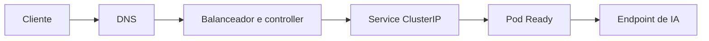

# Services, Ingress e conectividade ponta a ponta

Uma requisição de chat pode atravessar DNS público, balanceador, controlador de Ingress, Service e Pod antes de chamar o modelo. Um erro 502 pode surgir em qualquer transição. Entender esse caminho reduz tentativas de corrigir o código quando a causa está no roteamento.

## Service e Ingress

| Recurso ou tipo | Alcance e função | Uso |
|---|---|---|
| `ClusterIP` | IP estável interno ao cluster | Comunicação entre microsserviços |
| `NodePort` | Porta nos nós | Integrações específicas de infraestrutura |
| `LoadBalancer` | Balanceador provisionado pela integração Azure | Exposição direta; pode ser interno |
| Ingress | Regras HTTP/HTTPS por host e caminho | Compartilhar entrada e terminar TLS |

Um ==Ingress controller== implementa as regras. Criar apenas o objeto Ingress sem controller compatível não estabelece o proxy. Selecione um controller com suporte vigente e uma `IngressClass` existente; não presuma que todos os clusters trazem o mesmo controller instalado.



## Manifesto de rota

O exemplo pressupõe Service `api` na porta 80, controller instalado e classe `minha-classe` configurada. Substitua host, classe e Secret TLS por recursos reais.

```yaml
apiVersion: networking.k8s.io/v1
kind: Ingress
metadata:
  name: api
  namespace: ai200
spec:
  ingressClassName: minha-classe
  tls:
    - hosts:
        - api.exemplo.com
      secretName: api-tls
  rules:
    - host: api.exemplo.com
      http:
        paths:
          - path: /
            pathType: Prefix
            backend:
              service:
                name: api
                port:
                  number: 80
```

A porta referenciada é a `port` do Service, que encaminha para `targetPort` do Pod. O selector identifica endpoints prontos. DNS interno normalmente permite acessar `api.ai200.svc.cluster.local` de outros namespaces, respeitadas as políticas.

## Diagnóstico por salto

Confira resolução do host e certificado; examine status do Ingress e logs do controller. Depois verifique Service e EndpointSlices. Teste a aplicação por `kubectl port-forward` para separar falha do processo de falha no caminho de entrada. Esse teste não valida toda a rede real e não substitui uma chamada pelo endpoint público.

<details>
<summary>Checagem Rápida: Um Service sem endpoints é corrigido aumentando o timeout do Ingress?</summary>

Não. Confira labels, namespace, readiness e `targetPort`. Um proxy não consegue encaminhar para um conjunto vazio de backends.

</details>

## Pegadinhas de Prova

- **Pegadinha 1: LoadBalancer sempre é público**: A configuração pode solicitar balanceador interno.
- **Pegadinha 2: Ingress equivale a controller**: O objeto contém regras; o controller as implementa.
- **Pegadinha 3: Entrada saudável garante saída**: O Pod pode atender HTTP e ainda falhar ao resolver ou acessar o endpoint do modelo.
