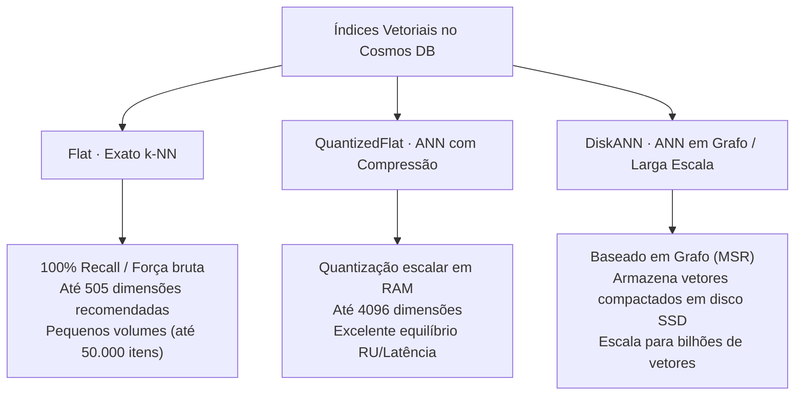

# Embeddings, Políticas Vetoriais e VectorDistance()

A integração de recursos de **Busca Vetorial Nativa** no **Azure Cosmos DB for NoSQL** transforma a base de dados transacional em um repositório unificado para arquiteturas RAG (Retrieval-Augmented Generation). Ao armazenar metadados, conteúdo textual e embeddings no mesmo documento JSON, a solução elimina a latência, a complexidade de sincronização e os custos adicionais decorrentes de manter bancos de dados relacionais e bancos vetoriais isolados.

---

## 1. Arquitetura de Embeddings no Cosmos DB NoSQL

Diferente de bancos de dados relacionais que exigem tipos de dados binários rígidos ou extensões como `pgvector`, o Cosmos DB manipula vetores como **arrays numéricos padrão no JSON**:
- Vetores de 1536 dimensões (`text-embedding-3-small`, `ada-002`) ou 3072 dimensões (`text-embedding-3-large`).
- Armazenamento co-localizado com propriedades de controle de acesso (`tenantId`, `userId`, `roles`) e metadados (`timestamp`, `tags`).

---

## 2. Configuração do Contêiner: `vectorEmbeddingPolicy`

Para que o Cosmos DB reconheça um array numérico como um embedding e aplique aceleração por hardware, é obrigatório registrar a política de embeddings na criação do contêiner:

A estrutura `vectorEmbeddingPolicy` requer quatro propriedades fundamentais:
1. `path`: Caminho JSON da propriedade vetorial (ex: `"/embedding"`).
2. `dataType`: Tipo primitivo numérico do vetor. Os tipos suportados são:
   - ==`float32`== (padrão e mais utilizado para modelos OpenAI).
   - `float16`, `int8`, `uint8` (para modelos com quantização prévia).
3. `dimensions`: Número inteiro que expressa o tamanho do espaço vetorial (até ==4096 dimensões==).
4. `distanceFunction`: Métrica matemática de distância espacial:
   - `cosine`: Similaridade de cosseno. Padrão ouro para busca semântica em textos (avalia o ângulo entre vetores, ignorando magnitude).
   - `dotproduct`: Produto escalar. Recomendado para vetores normalizados na norma $L_2$ por sua alta velocidade de computação.
   - `euclidean`: Distância Euclidiana ($L_2$). Avalia a distância linear absoluta no espaço vetorial.

---

## 3. Tipos de Índices Vetoriais: Flat, QuantizedFlat e DiskANN

Dentro da `indexingPolicy`, a seção `vectorIndexes` define o algoritmo de busca:



| Tipo de Índice | Mecanismo | Dimensões Máximas | Recall | Escala Recomendada |
|---|---|---|---|---|
| **Flat** | Força bruta (k-Nearest Neighbors exato). Compara a query contra cada item da partição. | Até 505 dimensões | ==100% (Exato)== | Coleções pequenas (< 50.000 itens) |
| **QuantizedFlat** | Comprime os vetores usando quantização escalar, mantendo os códigos quantizados na memória. | Até ==4096 dimensões== | ~95% (Aproximado) | Volumes médios; excelente relação de RUs |
| **DiskANN** | Algoritmo baseado em grafos desenvolvido pela Microsoft Research. Armazena o grafo em SSD. | Até ==4096 dimensões== | > 95% (Aproximado) | ==Larga escala (milhões a bilhões de vetores)== |

> **Atenção**: Para que os índices `quantizedFlat` e `diskANN` funcionem, a propriedade de vetor **deve ser obrigatoriamente excluída** de `excludedPaths` do índice invertido padrão.

---

## 4. Consultas com a Função SQL `VectorDistance()`

A função do sistema `VectorDistance()` calcula a similaridade espacial entre dois vetores dentro de consultas SQL:

$$\text{VectorDistance}(c.\text{embedding}, \quad @\text{queryVector})$$

### Sintaxe SQL Canônica para Busca Semântica
```sql
SELECT TOP 5
    c.id,
    c.text,
    c.category,
    VectorDistance(c.embedding, @queryVector) AS SimilarityScore
FROM c
WHERE c.category = @filterCategory AND c.tenantId = @tenantId
ORDER BY VectorDistance(c.embedding, @queryVector)
```

### Busca Híbrida e Filtragem Pré-Vetorial (Pre-Filtering)
O motor de consulta do Cosmos DB executa a filtragem de forma integrada:
1. Os filtros relacionais escalares na cláusula `WHERE` (como `c.category = @filterCategory`) são avaliados primeiro utilizando os **índices invertidos tradicionais**.
2. O subconjunto de documentos qualificados é então submetido ao grafo vetorial (**DiskANN**), que seleciona os $K$ vizinhos mais próximos.
3. Isso garante que permissões de segurança por tenant ou categoria sejam aplicadas antes da ordenação por relevância semântica.

<details>
<summary>Checagem Rápida: O que acontece se utilizarmos VectorDistance() apenas na cláusula WHERE sem ORDER BY?</summary>

Se você tentar executar `SELECT * FROM c WHERE VectorDistance(c.embedding, @vector) < 0.2`, o Cosmos DB **não utilizará o índice vetorial**. Ele será forçado a executar uma varredura completa da tabela (Full Table Scan), calculando a distância de cada item individualmente em tempo de execução, o que resultará em alto consumo de RUs e lentidão. O índice vetorial é ativado quando `VectorDistance()` é colocado na cláusula `ORDER BY`.
</details>

---

## 5. Implementação Prática Dual SDK (Python e C#)

Abaixo, a criação de um contêiner configurando a política vetorial com métrica `cosine`, índice `diskANN` e execução de busca vetorial parametrizada:

```python
from azure.identity import DefaultAzureCredential
from azure.cosmos import CosmosClient

endpoint = "https://ai200-cosmos-nosql.documents.azure.com:443/"
client = CosmosClient(url=endpoint, credential=DefaultAzureCredential())
database = client.get_database_client("KnowledgeBase")

# 1. Definição da Vector Embedding Policy
vector_embedding_policy = {
    "vectorEmbeddings": [
        {
            "path": "/embedding",
            "dataType": "float32",
            "dimensions": 1536,
            "distanceFunction": "cosine"
        }
    ]
}

# 2. Definição da Indexing Policy com DiskANN
indexing_policy = {
    "indexingMode": "consistent",
    "automatic": True,
    "includedPaths": [{"path": "/*"}],
    "excludedPaths": [{"path": "/embedding/*"}], # Exclui do índice invertido
    "vectorIndexes": [
        {
            "path": "/embedding",
            "type": "diskANN"
        }
    ]
}

container = database.create_container_if_not_exists(
    id="DocumentEmbeddings",
    partition_key={"paths": ["/tenantId"], "kind": "Hash"},
    indexing_policy=indexing_policy,
    vector_embedding_policy=vector_embedding_policy
)

# 3. Execução de Busca Vetorial com Parâmetro
query_vector = [0.0152, -0.0231, 0.0891] # Vetor de 1536 dimensões (resumido)
query_sql = """
SELECT TOP 3 c.id, c.text, VectorDistance(c.embedding, @vector) AS Score
FROM c
WHERE c.tenantId = @tenant
ORDER BY VectorDistance(c.embedding, @vector)
"""

results = container.query_items(
    query=query_sql,
    parameters=[
        {"name": "@vector", "value": query_vector},
        {"name": "@tenant", "value": "tenant-contoso"}
    ],
    partition_key="tenant-contoso"
)

for doc in results:
    print(f"ID: {doc['id']} | Similaridade: {doc['Score']}")
```

```csharp
using System;
using System.Collections.Generic;
using System.Collections.ObjectModel;
using System.Threading.Tasks;
using Azure.Identity;
using Microsoft.Azure.Cosmos;

string endpoint = "https://ai200-cosmos-nosql.documents.azure.com:443/";
CosmosClient client = new CosmosClient(endpoint, new DefaultAzureCredential());
Database database = client.GetDatabase("KnowledgeBase");

// 1. Configuração de ContainerProperties com política de embedding
ContainerProperties containerProperties = new ContainerProperties("DocumentEmbeddings", "/tenantId");

containerProperties.VectorEmbeddingPolicy = new VectorEmbeddingPolicy(
    new Collection<Embedding>
    {
        new Embedding
        {
            Path = "/embedding",
            DataType = VectorDataType.Float32,
            Dimensions = 1536,
            DistanceFunction = DistanceFunction.Cosine
        }
    }
);

// 2. Política de indexação vetorial com DiskANN
containerProperties.IndexingPolicy.ExcludedPaths.Add(new ExcludedPath { Path = "/embedding/*" });
containerProperties.IndexingPolicy.VectorIndexes.Add(
    new VectorIndexPath
    {
        Path = "/embedding",
        Type = VectorIndexType.DiskANN
    }
);

Container container = await database.CreateContainerIfNotExistsAsync(containerProperties);

// 3. Consulta vetorial com VectorDistance() e parâmetros
float[] queryVector = new float[] { 0.0152f, -0.0231f, 0.0891f }; // Representação conceitual

QueryDefinition queryDefinition = new QueryDefinition(
    @"SELECT TOP 3 c.id, c.text, VectorDistance(c.embedding, @vector) AS Score
      FROM c
      WHERE c.tenantId = @tenant
      ORDER BY VectorDistance(c.embedding, @vector)")
    .WithParameter("@vector", queryVector)
    .WithParameter("@tenant", "tenant-contoso");

using FeedIterator<dynamic> iterator = container.GetItemQueryIterator<dynamic>(
    queryDefinition,
    requestOptions: new QueryRequestOptions { PartitionKey = new PartitionKey("tenant-contoso") }
);

while (iterator.HasMoreResults)
{
    FeedResponse<dynamic> response = await iterator.ReadNextAsync();
    foreach (var item in response)
    {
        Console.WriteLine($"ID: {item.id} - Score: {item.Score}");
    }
}
```

---

## Pegadinhas de Prova

- **Imutabilidade da Vector Policy**: As políticas de vetores (`vectorEmbeddingPolicy`) e seus índices associados só podem ser definidos **no momento da criação do contêiner**. Você não pode habilitar busca vetorial em um contêiner existente sem recriá-lo e migrar os dados.
- **VectorDistance() obrigatório no ORDER BY**: Para utilizar o índice vetorial (DiskANN ou Flat), a função `VectorDistance()` deve estar presente no `ORDER BY`. Se você ordenar por outra coluna (ex: `ORDER BY c.createdAt`), o índice vetorial será ignorado e a consulta incorrerá em custo catastrófico de RUs.
- **Tipos de Dados dos Vetores**: O Cosmos DB valida estritamente a dimensionalidade do array no momento da gravação. Se a política especificar 1536 dimensões e você enviar um array com 1535 ou 1537 elementos, a operação de escrita será rejeitada com erro de validação de esquema (`HTTP 400 Bad Request`).
- **DiskANN vs Flat**: Em questões que descrevem catálogos pequenos (< 30.000 itens) ou que exigem garantia absoluta de precisão exata (100% recall), a resposta correta é o índice **Flat**. Quando a questão menciona milhões de itens, larga escala ou alta taxa de transferência, a resposta correta é **DiskANN**.
