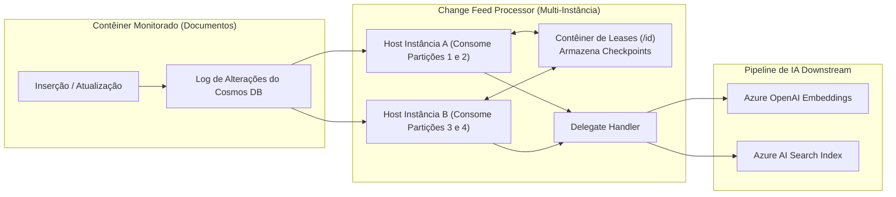

# Change Feed Processor: Leases, Delegates e Reprocessamento

O **Azure Cosmos DB Change Feed** é um mecanismo orientado a eventos que escuta e emite alterações efetuadas em contêineres do Cosmos DB em ordem estrita de ocorrência. Em soluções modernas de Inteligência Artificial e RAG (Retrieval-Augmented Generation), o Change Feed atua como a espinha dorsal assíncrona responsável por disparar a vetorização de novos documentos, atualizar caches semânticos no **Azure Managed Redis** e manter índices externos (como o **Azure AI Search**) sincronizados em tempo quase real.

---

## 1. Arquitetura e Princípios de Funcionamento

O Change Feed é um log persistente e somente de acréscimo (append-only) que opera nativamente sobre as partições físicas e lógicas do contêiner monitorado:
- **Ordem Garantida**: As alterações são garantidas em ordem cronológica estrita **dentro de cada partição lógica**. Não há garantia de ordenação global entre partições lógicas distintas.
- **Disponibilidade Imediata**: As alterações persistem imediatamente após a confirmação da transação de escrita (commit).
- **Consumo Desacoplado**: Múltiplos sistemas downstream independentes podem ler o mesmo Change Feed no seu próprio ritmo sem impactar o desempenho do banco transacional.



---

## 2. Componentes da Biblioteca Change Feed Processor (CFP)

A biblioteca oficial **Change Feed Processor (CFP)** é a camada recomendada para consumo distribuído e tolerante a falhas do Change Feed. Ela é composta por quatro elementos essenciais:

1. **Contêiner Monitorado (Monitored Container)**: O contêiner de dados que gera os eventos de escrita.
2. **Contêiner de Leases (Leases Container)**: Um contêiner auxiliar do Cosmos DB que atua como coordenador de estado distribuído. Ele armazena um "lease" (contrato de concessão) para cada partição física, registrando o identificador do host proprietário e o **continuation token** (checkpoint) do último item processado com sucesso.
   - **Regra Mandatória**: O contêiner de leases deve ser configurado com chave de partição definida como ==`/id`==.
3. **Host de Computação (Host Instance)**: A instância de aplicação que executa o processador (ex: um pod no AKS, um contêiner no Azure Container Apps ou uma WebJob). Se múltiplos hosts compartilharem o mesmo nome de processador, o CFP distribui as partições físicas automaticamente entre eles (**auto-balancing**).
4. **Delegate**: O manipulador de código (callback assíncrono) que recebe o lote de documentos alterados (`IReadOnlyCollection<T>`) e executa a lógica de negócio.

---

## 3. Modos do Change Feed: Latest Version vs All Versions and Deletes

O Cosmos DB disponibiliza dois modos operacionais para leitura de alterações:

| Característica | Latest Version Mode (Padrão) | All Versions and Deletes Mode (AVD) |
|---|---|---|
| **Eventos Capturados** | Inserções e Atualizações | Inserções, Atualizações e ==Exclusões Físicas== |
| **Representação de Dados** | Retorna o estado atual consolidado do item | Retorna a imagem anterior e a versão modificada |
| **Captura de Deletes** | ==Não captura deleções físicas== (Exige padrão Soft Delete) | Captura nativamente com metadados de exclusão |
| **Janela de Retenção** | Histórico completo permanente desde a criação do contêiner | Retenção contínua baseada em janela temporal (ex: 7 dias) |
| **Configuração** | Habilitado por padrão em todas as contas | Requer ativação explícita no contêiner e conta |

<details>
<summary>Checagem Rápida: Como capturar remoções de documentos no modo Latest Version sem perder integridade no RAG?</summary>

Adote o padrão **Soft Delete**: em vez de invocar a exclusão física do item (`DeleteItem`), atualize o documento inserindo a flag `isDeleted: true` e configure um `ttl` (Time to Live) de alguns dias. O Change Feed emitirá a atualização com `isDeleted: true`, permitindo que o delegate remova o vetor do Azure AI Search. Após o TTL expirar, o Cosmos DB purgará o documento automaticamente sem custos adicionais de RU.
</details>

---

## 4. Casos de Uso em Inteligência Artificial e RAG

O Change Feed é o componente chave para sincronização de estados em IA:
- **Geração Assíncrona de Embeddings**: Ao salvar documentos brutos no Cosmos DB, o delegate do CFP extrai o texto, chama a API de Embeddings do Azure OpenAI e salva o vetor de volta no contêiner vetorial. Isso desacopla a latência da API do OpenAI da transação do usuário.
- **Invalidação de Cache Semântico**: Quando um produto ou documento de FAQ tem seu preço ou conteúdo alterado, o Change Feed notifica o serviço para purgar as chaves correspondentes no **Azure Managed Redis**.
- **Reprocessamento Histórico**: Ao atualizar para um modelo de embedding superior (ex: migrando de `text-embedding-ada-002` para `text-embedding-3-large`), você pode inicializar um novo CFP apontando o parâmetro `StartTime = DateTime.MinValue` para reprocessar toda a base desde o início.

---

## 5. Implementação Prática Dual SDK (Python e C#)

Abaixo, a implementação completa do Change Feed Processor com balanceamento distribuído em C# e o consumo via Pull Model Iterator em Python:

```python
from azure.identity import DefaultAzureCredential
from azure.cosmos import CosmosClient

endpoint = "https://ai200-cosmos-nosql.documents.azure.com:443/"
client = CosmosClient(url=endpoint, credential=DefaultAzureCredential())

database = client.get_database_client("KnowledgeBase")
container = database.get_container_client("Documents")

# Consumo do Change Feed via Pull Model em Python
# query_items_change_feed monitora alterações a partir do início ou de um token prévio
change_feed_iterator = container.query_items_change_feed(
    partition_key_range_id=None, # Escuta em todas as partições lógicas da partição física
    is_start_from_beginning=True
)

print("Iniciando escuta do Change Feed (Python Pull Model)...")
for item in change_feed_iterator:
    # Dispara geração de embedding para novo documento
    doc_id = item.get("id")
    content = item.get("content", "")
    print(f"Documento alterado detectado: {doc_id}. Disparando embedding para: {content[:30]}...")
```

```csharp
using System;
using System.Collections.Generic;
using System.Threading;
using System.Threading.Tasks;
using Azure.Identity;
using Microsoft.Azure.Cosmos;

string endpoint = "https://ai200-cosmos-nosql.documents.azure.com:443/";
CosmosClient client = new CosmosClient(endpoint, new DefaultAzureCredential());

Container monitoredContainer = client.GetContainer("KnowledgeBase", "Documents");
Container leasesContainer = client.GetContainer("KnowledgeBase", "leases");

// 1. Definição do Delegate Handler assíncrono
async Task ProcessChangesAsync(
    ChangeFeedProcessorContext context,
    IReadOnlyCollection<dynamic> changes,
    CancellationToken cancellationToken)
{
    Console.WriteLine($"Lote recebido com {changes.Count} alterações. Partição física: {context.LeaseToken}");
    foreach (var item in changes)
    {
        string id = item.id;
        string text = item.content;
        // Chamada assíncrona ao modelo de embeddings do Azure OpenAI
        Console.WriteLine($"Gerando embeddings para documento {id}...");
    }
    await Task.CompletedTask;
}

// 2. Construção do ChangeFeedProcessor com suporte a auto-balancing
ChangeFeedProcessor processor = monitoredContainer
    .GetChangeFeedProcessorBuilder<dynamic>(processorName: "EmbeddingSyncPipeline", onChangesDelegate: ProcessChangesAsync)
    .WithInstanceName("Worker-Node-01") // Identificador único da réplica/pod atual
    .WithLeaseContainer(leasesContainer)
    .WithStartTime(DateTime.UtcNow.AddHours(-1)) // Inicia a escuta a partir de 1 hora atrás
    .Build();

// 3. Inicialização e execução contínua
await processor.StartAsync();
Console.WriteLine("Change Feed Processor ativo e consumindo alterações...");

// Aguarda sinal de encerramento gracioso
// await processor.StopAsync();
```

---

## Pegadinhas de Prova

- **Deleções no modo Latest Version**: Em testes práticos e exames oficiais, uma pergunta recorrente afirma que o Change Feed padrão notifica quando um documento é excluído via `DELETE`. **Isto é FALSO!** No modo padrão (`Latest Version`), deleções físicas são completamente ignoradas. Para registrar deleções sem ativar o modo AVD, adote o padrão **Soft Delete** (`isDeleted = true`).
- **Chave de Partição do Contêiner de Leases**: O contêiner de leases **deve obrigatoriamente** ter sua chave de partição definida como `/id`. Definir qualquer outro caminho (como `/leaseId` ou `/partitionKey`) causará exceção na inicialização do `ChangeFeedProcessorBuilder`.
- **Tratamento de Exceções no Delegate**: Se o delegate do Change Feed Processor lançar uma exceção não tratada (`Unhandled Exception`), o processador **não avançará o checkpoint** daquela partição. Ele repetirá o mesmo lote de alterações indefinidamente, travando o pipeline daquela partição física (veneno de fila). É indispensável envolver a lógica do delegate em blocos `try/catch` e enviar mensagens com falha persistente para uma Dead-Letter Queue (como Azure Service Bus).
- **Escalabilidade e Partições Físicas**: Se o contêiner monitorado possui 4 partições físicas e você sobe 10 instâncias de trabalhadores (pods) com o mesmo nome de processador, apenas 4 instâncias receberão leases ativos e trabalharão simultaneamente; as outras 6 ficarão em standby ocioso. Não é possível ter mais trabalhadores ativos simultâneos do que o número de partições físicas do contêiner.
