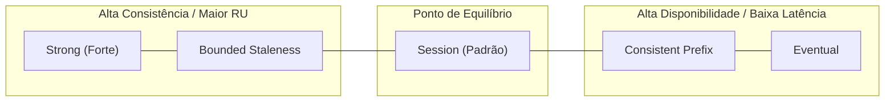

# Políticas de Indexação, Níveis de Consistência e Otimização de RUs

No **Azure Cosmos DB for NoSQL**, a taxa de transferência (throughput), o modelo de consistência distribuída e as políticas de indexação estão intrinsecamente conectados. Para cargas de trabalho de Inteligência Artificial — onde documentos transacionais convivem com vetores de alta dimensionalidade — o ajuste fino desses três pilares evita desperdício financeiro e garante tempos de resposta previsíveis.

---

## 1. Políticas de Indexação: Inverted Index e Otimização para IA

Por padrão, o Azure Cosmos DB adota uma política de indexação automática: **todas as propriedades de todos os itens são indexadas por padrão** (`/*`).
- O índice subjacente é um índice invertido baseado em árvore, estruturado para responder com agilidade a buscas por predicados de igualdade, intervalos numéricos e verificações espaciais.

### O Risco do Índice Padrão para Embeddings Vetoriais
Se um documento armazena um vetor de embedding (por exemplo, 1.536 números em ponto flutuante gerados pelo Azure OpenAI):
```json
{
  "id": "chunk-102",
  "documentId": "manual-ti",
  "text": "Procedimento de reinicialização do cluster...",
  "embedding": [0.0124, -0.0431, 0.0892, "... 1536 floats ..."]
}
```
A política padrão tentará criar entradas no índice invertido para **cada uma das 1.536 posições numéricas do array**. Isso provoca:
1. **Explosão no Custo de Gravação (RU/s)**: A inserção do documento pode saltar de 5-8 RUs para mais de ==60 a 90 RUs== por item gravado.
2. **Inflação de Armazenamento**: O armazenamento de índice no disco ultrapassa o tamanho do próprio documento de dados.

### A Solução: Exclusão de Caminho (Excluded Paths)
É mandatório adicionar o caminho do vetor (ex: `"/embedding/*"`) na lista de ==excludedPaths== do índice invertido. Dessa forma, o vetor é indexado exclusivamente pelo motor vetorial (DiskANN ou QuantizedFlat), economizando até 85% de RUs de gravação.

### Índices Compostos (Composite Indexes)
Índices compostos são obrigatórios no Cosmos DB em dois cenários principais de consulta:
1. Consultas que possuem `ORDER BY` com múltiplas propriedades (ex: `SELECT * FROM c ORDER BY c.tenantId ASC, c.createdAt DESC`).
2. Consultas que combinam filtro de igualdade com filtro de intervalo e ordenação sobre campos distintos.

---

## 2. Os 5 Níveis de Consistência: Trade-offs de RUs e Latência

O Cosmos DB oferece 5 níveis de consistência bem definidos no teorema PACELC, permitindo balancear exatidão de dados e desempenho:



| Nível de Consistência | Garantia Fundamental | Custo de RU na Leitura | Latência de Escrita | Multi-Region Write |
|---|---|---|---|---|
| **Strong** | Linearizável; RPO = 0; leituras sempre retornam o valor mais recente com quórum. | ==2x RUs== (Quórum de 2 réplicas) | Maior latência (quórum síncrono) | Não suportado (apenas single-write region) |
| **Bounded Staleness** | Atraso delimitado por no máximo $K$ versões ou $T$ segundos. | ==2x RUs== (Leitura em 2 réplicas) | Moderada | Suportado (apenas single-write region) |
| **Session (Padrão)** | Leitura das próprias gravações (Read-your-own-writes) dentro do token de sessão do cliente. | ==1x RU== | Baixa (< 10 ms) | Suportado |
| **Consistent Prefix** | Leituras nunca veem atualizações fora de ordem (sem dirty reads ou reordenações). | ==1x RU== | Baixa | Suportado |
| **Eventual** | Sem garantia de ordem cronológica imediata; converge assincronamente. | ==1x RU== | Mínima | Suportado |

<details>
<summary>Checagem Rápida: Por que as leituras sob consistência Strong custam o dobro de RUs?</summary>

Porque para garantir linearizabilidade absoluta sem leituras fantasmas ou desatualizadas, o Cosmos DB precisa consultar simultaneamente pelo menos duas réplicas locais do quórum de quatro nós para validar que a versão lida é consenso antes de entregar os dados ao cliente.
</details>

---

## 3. Dimensionamento de Request Units (RU/s) e Modos de Throughput

A **Request Unit (RU)** é a moeda de computação do Cosmos DB, abstraindo CPU, memória e IOPS:
- 1 RU normalizada equivale à leitura pontual (Point Read) de 1 item JSON de 1 KB sob Session Consistency.

### Manual vs Autoscale Throughput
- **Throughput Manual**: Você provisiona um valor fixo (mínimo de 400 RU/s). Paga-se pela quantidade alocada de forma contínua por hora, independentemente do consumo real.
- **Autoscale Throughput**: Você define uma taxa máxima $T_{\max}$ (ex: 4.000 RU/s). O Cosmos DB escala o throughput instantaneamente de segundo a segundo dentro do intervalo:

$$\text{Throughput Disponível} = [ 0.10 \times T_{\max}, \quad T_{\max} ]$$

Para um contêiner com Autoscale de 4.000 RU/s, a capacidade oscila automaticamente entre ==400 RU/s== (em momentos ociosos) e ==4.000 RU/s== (em picos de tráfego), gerando economia significativa em cargas de IA com padrões esporádicos de uso.

---

## 4. Mitigação de Throttling (HTTP 429 Too Many Requests)

Quando o volume de operações excede a capacidade de RU/s provisionada na partição física no segundo atual, o Cosmos DB rejeita a requisição retornando o código de status ==HTTP 429 Too Many Requests== acompanhado pelo cabeçalho HTTP `x-ms-retry-after-ms`.

### Estratégias de Engenharia para Resiliência
1. **Configuração de Retry do SDK**: O SDK oficial inclui retentativa automática com backoff exponencial. Por padrão, ele tenta até 9 vezes antes de propagar a exceção para o código cliente.
2. **Habilitar Autoscale**: Evita gargalos em picos previsíveis de uso.
3. **Desacoplamento por Fila**: Inserir uma fila do **Azure Service Bus** antes de processos batch de ingestão de embeddings, atuando como amortecedor de picos (load leveling).
4. **Alinhamento da Chave de Partição**: Eliminar **hot partitions** que concentram tráfego em um único nó físico.

---

## 5. Implementação Prática com SDKs

Abaixo, a configuração de uma política de indexação com exclusão explícita de campos de vetores, índice composto para ordenação múltipla e configuração de Autoscale:

```python
from azure.identity import DefaultAzureCredential
from azure.cosmos import CosmosClient, ThroughputProperties

endpoint = "https://ai200-cosmos-nosql.documents.azure.com:443/"
client = CosmosClient(url=endpoint, credential=DefaultAzureCredential())
database = client.get_database_client("KnowledgeBase")

# Política de indexação com exclusão de vetores e índice composto
indexing_policy = {
    "indexingMode": "consistent",
    "automatic": True,
    "includedPaths": [{"path": "/*"}],
    "excludedPaths": [
        {"path": "/embedding/*"}, # Exclusão mandatória para vetores de IA
        {"path": "/\"_etag\"/?"}
    ],
    "compositeIndexes": [
        [
            {"path": "/tenantId", "order": "ascending"},
            {"path": "/createdAt", "order": "descending"}
        ]
    ]
}

container = database.create_container_if_not_exists(
    id="OptimizedChunks",
    partition_key={"paths": ["/tenantId"], "kind": "Hash"},
    indexing_policy=indexing_policy,
    offer_throughput=ThroughputProperties(auto_scale_max_throughput=5000)
)
print("Contêiner criado com política de indexação otimizada.")
```

```csharp
using System;
using System.Collections.ObjectModel;
using System.Threading.Tasks;
using Azure.Identity;
using Microsoft.Azure.Cosmos;

string endpoint = "https://ai200-cosmos-nosql.documents.azure.com:443/";
CosmosClient client = new CosmosClient(endpoint, new DefaultAzureCredential());
Database database = client.GetDatabase("KnowledgeBase");

ContainerProperties containerProperties = new ContainerProperties("OptimizedChunks", "/tenantId");

// 1. Excluir vetor de embeddings do índice invertido
containerProperties.IndexingPolicy.IncludedPaths.Add(new IncludedPath { Path = "/*" });
containerProperties.IndexingPolicy.ExcludedPaths.Add(new ExcludedPath { Path = "/embedding/*" });

// 2. Configurar índice composto para suportar ORDER BY c.tenantId ASC, c.createdAt DESC
Collection<CompositePath> compositePaths = new Collection<CompositePath>
{
    new CompositePath { Path = "/tenantId", Order = CompositePathSortOrder.Ascending },
    new CompositePath { Path = "/createdAt", Order = CompositePathSortOrder.Descending }
};
containerProperties.IndexingPolicy.CompositeIndexes.Add(compositePaths);

// 3. Autoscale Throughput com teto de 5.000 RU/s (escala de 500 a 5000)
ThroughputProperties throughput = ThroughputProperties.CreateAutoscaleThroughput(5000);

Container container = await database.CreateContainerIfNotExistsAsync(containerProperties, throughput);
Console.WriteLine($"Contêiner {container.Id} provisionado com sucesso.");
```

---

## Pegadinhas de Prova

- **Ordem das Propriedades no Índice Composto**: A ordem e a direção (`ascending` / `descending`) dos campos declarados no índice composto **devem coincidir rigorosamente** com a cláusula `ORDER BY` da consulta SQL. Se o índice composto for configurado como `(tenantId ASC, createdAt DESC)` e a consulta solicitar `ORDER BY c.tenantId ASC, c.createdAt ASC`, o Cosmos DB rejeitará a consulta com erro exigindo novo índice composto.
- **Strong Consistency em Multi-Region Write**: O Cosmos DB **não suporta** consistência Strong em contas configuradas com gravações em múltiplas regiões (Multi-Region Writes). Se uma questão de prova exigir gravações ativas em múltiplos locais geográficos com replicação multimestre, a consistência máxima configurável é **Bounded Staleness** ou **Session**.
- **O Token de Sessão entre Microsserviços**: Em ambientes com Session Consistency, o isolamento "read-your-own-writes" depende da propagação do `x-ms-session-token`. Se o usuário grava dados via Microsserviço A e em seguida lê via Microsserviço B, o Microsserviço B pode ler dados defasados a menos que o token de sessão seja repassado explicitamente entre eles via cabeçalho HTTP.
- **Piso Financeiro do Autoscale**: O piso de consumo do Autoscale é sempre **10% do valor máximo configurado**. Um contêiner configurado com Autoscale de 10.000 RU/s será faturado por no mínimo 1.000 RU/s em todas as horas, mesmo que passe a madrugada inteira com tráfego zero.
