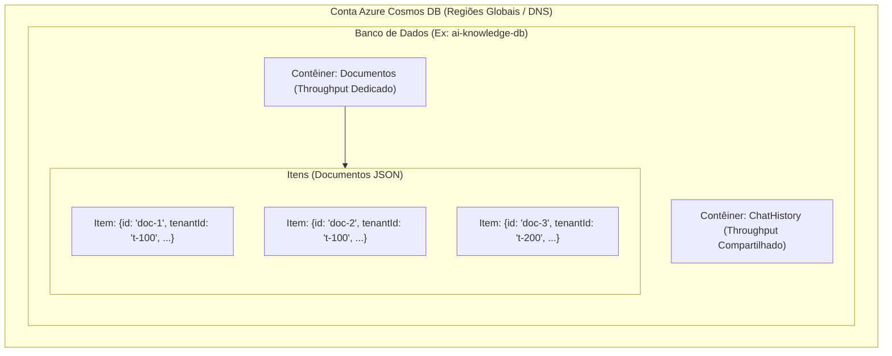
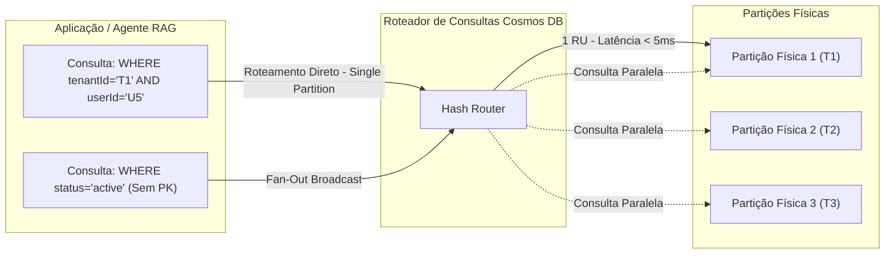

# Modelo de Recursos, Partition Key e Request Units

O **Azure Cosmos DB for NoSQL** é uma base de dados distribuída globalmente, multimestre e com garantia de latência de um dígito de milissegundo no percentil 99. Para cargas de trabalho de Inteligência Artificial — como memória de conversação para agentes, armazenamento de perfis e catálogos vetoriais em arquiteturas RAG (Retrieval-Augmented Generation) — a compreensão minuciosa da hierarquia de recursos e da estratégia de particionamento é determinante para a escalabilidade e o controle financeiro da solução.

---

## 1. Hierarquia do Modelo de Recursos

O modelo de entidades do Azure Cosmos DB é estritamente hierárquico:

1. **Conta do Azure Cosmos DB (Account)**: Unidade administrativa fundamental de provisionamento, governança, segurança e replicação geográfica. Define o endpoint DNS global (`https://<account>.documents.azure.com:443/`), as políticas de firewall, chaves mestras e o suporte a Microsoft Entra ID (RBAC).
2. **Banco de Dados (Database)**: Agrupador lógico análogo a um namespace. Permite gerenciar segurança de usuários e, opcionalmente, provisionar **throughput compartilhado** entre múltiplos contêineres subordinados.
3. **Contêiner (Container)**: Unidade operacional de escalabilidade. É no contêiner que residem as definições da **chave de partição (Partition Key)**, as **políticas de indexação**, as **políticas de vetores (vectorEmbeddingPolicy)** e o throughput provisionado (dedicado). No SQL API, contêineres também são referenciados como coleções.
4. **Item (Item)**: Documento JSON armazenado dentro do contêiner. Cada item possui obrigatoriamente um atributo `id` (string única dentro da sua partição lógica) e o valor associado à chave de partição definida no contêiner.



---

## 2. Particionamento: Partições Lógicas vs Partições Físicas

O Cosmos DB escala linearmente tanto em armazenamento quanto em taxa de transferência (throughput) através do particionamento horizontal transparente.

### Partição Lógica
Uma partição lógica é o agrupamento de todos os itens de um contêiner que possuem o mesmo valor para a chave de partição (`partitionKey`).
- O limite máximo estrito de armazenamento por partição lógica é de ==20 GB==.
- Não há limite para a quantidade de partições lógicas que um contêiner pode conter.
- Todas as operações de leitura, escrita e transações em lote (stored procedures e transactional batches) dentro da mesma partição lógica são executadas com garantia atômica e suporte total a transações ACID.

### Partição Física
Uma partição física é um nó de infraestrutura de computação e armazenamento gerenciado internamente pelo Azure. Cada partição física é replicada por meio de um conjunto de réplicas de quatro nós (quórum Paxos) para garantir alta disponibilidade.
- Cada partição física armazena até ==50 GB== de dados.
- Cada partição física suporta um throughput máximo de ==10.000 RU/s==.
- As partições lógicas são distribuídas automaticamente entre as partições físicas disponíveis.

Quando o armazenamento total de uma partição física atinge o limiar de 50 GB ou quando o throughput alocado requer nova infraestrutura, o Cosmos DB executa automaticamente uma **divisão de partição (partition split)** sem causar indisponibilidade na aplicação.

<details>
<summary>Checagem Rápida: O que acontece se uma única partição lógica atingir 20 GB?</summary>

Se uma única partição lógica atingir 20 GB de dados acumulados, qualquer tentativa subsequente de inserir novos itens nessa mesma chave de partição resultará em uma exceção de limite excedido (`HTTP 403 Forbidden` com substatus de storage limit exceeded). A aplicação fica impedida de gravar novos dados para aquela chave específica até que documentos sejam deletados ou uma chave hierárquica seja adotada.
</details>

---

## 3. Seleção de Partition Key e Mitigação de Hot Partitions

A escolha da chave de partição é a decisão arquitetural mais crítica no Cosmos DB. Uma chave inadequada resulta em **Hot Partitions** (pontos quentes), que ocorrem sob dois formatos:
1. **Hot Partition de Armazenamento**: Ocorre quando um valor de chave concentra um volume desproporcional de dados, aproximando-se do teto de 20 GB.
2. **Hot Partition de Throughput**: Ocorre quando a esmagadora maioria das requisições acessa a mesma partição física, esgotando o limite local de RU/s e gerando erros ==HTTP 429 Too Many Requests==, mesmo que o contêiner possua dezenas de milhares de RU/s ociosas globalmente.

### Critérios para uma Chave de Alta Eficiência
- **Alta Cardinalidade**: A propriedade deve possuir centenas ou milhares de valores distintos (ex: `userId`, `tenantId`, `deviceId`), evitando propriedades binárias ou de baixa variação (como `status`, `gender` ou `country`).
- **Distribuição Uniforme de Consultas e Gravações**: O tráfego de leitura e escrita deve ser espalhado uniformemente ao longo do tempo.
- **Roteamento Direcionado**: A propriedade deve ser conhecida e incluída na cláusula `WHERE` da grande maioria das consultas de alto volume, garantindo **Point Reads** ou **Single-Partition Queries** e evitando consultas do tipo **Cross-Partition Fan-Out**.

---

## 4. Chaves de Partição Hierárquicas (Hierarchical Partition Keys - HPK)

Em cargas de trabalho de IA multitenant, a escolha entre `tenantId` e `userId` representava um dilema histórico:
- Escolher `/tenantId` arriscava violar o limite de 20 GB se uma grande empresa gerasse milhões de interações.
- Escolher `/userId` ou `/sessionId` dispersava os dados do mesmo cliente corporativo por dezenas de partições físicas, inviabilizando consultas administrativas por tenant sem broadcast cross-partition.

As **Chaves de Partição Hierárquicas (HPK)** solucionam esse desafio permitindo a definição de até ==3 níveis== de partição (subparticionamento):

$$\text{PartitionKey} = [ \text{Nível 1}, \text{Nível 2}, \text{Nível 3} ]$$

Exemplo típico para agentes de IA: `["/tenantId", "/userId", "/sessionId"]`.

### Vantagens Arquiteturais
- **Eliminação do Limite de 20 GB por Tenant**: O teto de 20 GB passa a ser aplicado à tupla combinada `(tenantId, userId, sessionId)`. Um único tenant pode agora crescer indefinidamente para centenas de terabytes.
- **Consultas Eficientes por Escopo**:
  - Filtro por `tenantId`: O roteador limita a busca às partições físicas que hospedam aquele tenant.
  - Filtro por `tenantId` e `userId`: Busca altamente direcionada.
  - Filtro por `tenantId`, `userId` e `sessionId`: Executada como **Single-Partition Query**, consumindo o mínimo de RUs.

---

## 5. Implementação Prática com SDKs

Abaixo, a criação programática de um contêiner configurando chaves de partição hierárquicas e throughput Autoscale com os SDKs oficiais:

```python
from azure.identity import DefaultAzureCredential
from azure.cosmos import CosmosClient, PartitionKey, ThroughputProperties

endpoint = "https://ai200-cosmos-nosql.documents.azure.com:443/"
credential = DefaultAzureCredential()

client = CosmosClient(url=endpoint, credential=credential)
database = client.create_database_if_not_exists(id="KnowledgeBase")

# Definição de chave hierárquica em 3 níveis (/tenantId, /userId, /sessionId)
container = database.create_container_if_not_exists(
    id="AgentMemories",
    partition_key=PartitionKey(
        path=["/tenantId", "/userId", "/sessionId"],
        kind="MultiHash"
    ),
    offer_throughput=ThroughputProperties(auto_scale_max_throughput=4000)
)

print(f"Container {container.id} pronto com particionamento hierárquico e Autoscale 4000 RU/s.")
```

```csharp
using System;
using System.Collections.Generic;
using System.Threading.Tasks;
using Azure.Identity;
using Microsoft.Azure.Cosmos;

string endpoint = "https://ai200-cosmos-nosql.documents.azure.com:443/";
CosmosClient client = new CosmosClient(endpoint, new DefaultAzureCredential());

Database database = await client.CreateDatabaseIfNotExistsAsync("KnowledgeBase");

// Configuração de chave de partição hierárquica em 3 níveis
ContainerProperties containerProperties = new ContainerProperties(
    id: "AgentMemories",
    partitionKeyPaths: new List<string> { "/tenantId", "/userId", "/sessionId" }
);

// Autoscale configurado com teto de 4.000 RU/s (escala dinâmica entre 400 e 4000 RU/s)
ThroughputProperties throughputProperties = ThroughputProperties.CreateAutoscaleThroughput(4000);

Container container = await database.CreateContainerIfNotExistsAsync(
    containerProperties,
    throughputProperties
);

Console.WriteLine($"Container {container.Id} criado com particionamento hierárquico.");
```

---

## 6. Diagrama de Roteamento de Consultas



---

## Pegadinhas de Prova

- **Imutabilidade da Partition Key**: Não é possível alterar, renomear ou adicionar novos caminhos de chave de partição a um contêiner existente após sua criação. Caso seja necessário mudar a partition key, a solução homologada no exame é criar um novo contêiner com a nova chave e migrar os dados usando o **Azure Cosmos DB Change Feed** ou o **Azure Data Factory**.
- **Unicidade de Identificador (id)**: O identificador `id` de um documento **não** precisa ser globalmente único dentro do contêiner. A unicidade é garantida pela combinação de `(id, partitionKey)`. Dois documentos podem ter o mesmo `id = "1"` se pertencerem a partições lógicas diferentes.
- **Divisão de RUs entre Partições Físicas**: O throughput provisionado (manual ou autoscale) é dividido igualmente entre todas as partições físicas subjacentes. Se um contêiner possui 30.000 RU/s provisionadas e 3 partições físicas, cada uma receberá exatamente 10.000 RU/s. Um pico de acessos concentrado em uma única partição física causará erro 429, mesmo que a conta esteja utilizando menos de 35% da sua capacidade total agregada.
- **Ordem dos Níveis nas Chaves Hierárquicas**: Na chave hierárquica, a ordem importa! Se a definição for `["/tenantId", "/userId", "/sessionId"]`, você pode podar partições filtrando apenas por `tenantId`, ou por `tenantId` e `userId`. No entanto, se uma consulta filtrar apenas por `userId` sem informar o `tenantId`, o roteador será forçado a executar um broadcast cross-partition.
