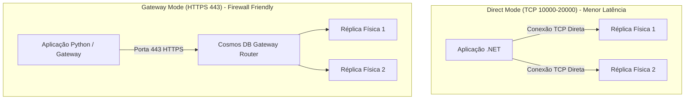

# SDK: CosmosClient, CRUD, Consultas Parametrizadas e Paginação

O desenvolvimento de soluções de Inteligência Artificial sobre o **Azure Cosmos DB for NoSQL** exige o domínio dos padrões arquiteturais dos SDKs oficiais. Escolhas incorretas na instanciação de clientes, no modo de transporte de rede ou na formulação de consultas SQL podem gerar esgotamento de portas de rede (socket exhaustion), custos desnecessários em Request Units (RU/s) e degradação severa na latência de geração de respostas para usuários finais.

---

## 1. Ciclo de Vida do Cliente e Padrão Singleton

O cliente do SDK (`CosmosClient`) foi projetado para ser thread-safe e gerenciar internamente o pool de conexões TCP, caches de roteamento de partições e metadados de esquemas.

- **Regra Mandatória**: O `CosmosClient` deve ser instanciado como ==singleton== (uma única instância compartilhada por toda a vida útil do processo da aplicação).
- **Anti-padrão Crítico**: Criar uma nova instância de `CosmosClient` por requisição HTTP ou a cada invocação de uma Azure Function resulta em **socket exhaustion** (esgotamento de portas locais TCP), tempo excessivo de handshake TLS e perda contínua dos caches de roteamento de partições.

---

## 2. Modos de Conexão: Direct Mode vs Gateway Mode

O SDK oferece dois modos de comunicação de rede entre a aplicação e o cluster do Cosmos DB:

| Característica | Direct Mode (Modo Direto) | Gateway Mode (Modo Gateway) |
|---|---|---|
| **Protocolo** | TCP | HTTPS |
| **Portas de Rede** | `10000 a 20000` (e até `65535`) | Apenas porta `443` |
| **Arquitetura** | Conecta-se diretamente às réplicas de dados | Salto intermediário através de nós de gateway |
| **Latência** | Ultrabaixa (1 salto de rede) | Adiciona latência residual do gateway proxy |
| **Padrão no .NET** | ==Sim (Padrão no SDK C#)== | Não (opcional) |
| **Padrão no Python**| Não suportado (Python opera via REST/HTTPS) | ==Sim (Padrão no SDK Python)== |
| **Cenário de Uso** | Aplicações de alto desempenho, microsserviços em AKS e Container Apps | Ambientes corporativos com firewalls rígidos bloqueando portas TCP |



<details>
<summary>Checagem Rápida: Em que situação você deve forçar o Gateway Mode em uma aplicação .NET?</summary>

Quando a aplicação corporativa é executada em uma rede restrita cujo firewall de saída bloqueia o tráfego TCP nas portas 10000 a 20000, permitindo apenas a porta 443 (HTTPS). Nesses casos, o Direct Mode falhará com timeouts de conexão e o Gateway Mode deve ser explicitamente habilitado nas `CosmosClientOptions`.
</details>

---

## 3. Point Reads vs Consultas SQL: Otimização de RUs

No Cosmos DB, operações de leitura são cobradas com base na complexidade computacional:

### Point Read
A operação de **Point Read** recupera um único documento conhecendo seu identificador `id` e o valor da sua `partition_key`.
- O Point Read ignora completamente o motor de análise e compilação de consultas SQL do Cosmos DB.
- Custa exatamente ==1 RU== para um item com tamanho de até 1 KB sob o nível de consistência Session.
- Métodos nos SDKs: `read_item(...)` em Python e `ReadItemAsync<T>(...)` em C#.

### Read via Consulta SQL
Quando a aplicação utiliza uma consulta SQL (ex: `SELECT * FROM c WHERE c.id = @id AND c.tenantId = @tenant`), a requisição transita pelo pipeline do otimizador de consultas SQL:
- Consome entre ==2.5 e 4 RUs== para o mesmo item de 1 KB.
- Apresenta latência ligeiramente superior ao Point Read.

> **Regra de Ouro para Prova**: Sempre que o código dispuser do `id` e da `partitionKey`, utilize operações de Point Read em vez de consultas SQL `SELECT`.

---

## 4. Consultas Parametrizadas e Prevenção de Injeção de Código

Consultas SQL no Cosmos DB devem ser formuladas utilizando **parâmetros nomeados** (iniciados com `@`):
- **Segurança**: Previne ataques de injeção de SQL NoSQL.
- **Eficiência e Cache**: O Cosmos DB realiza o cache do plano de execução da consulta parametrizada, reutilizando a compilação entre requisições subsequentes.

---

## 5. Paginação Eficiente com Feed Iterator e Continuation Tokens

Consultas que retornam múltiplos itens dividem os resultados em páginas gerenciadas por **Continuation Tokens**:
- O `ContinuationToken` é uma string opaca codificada que armazena o estado interno de leitura e a partição atual do cursor.
- O parâmetro `max_item_count` (Python) ou `MaxItemCount` (C#) define o número máximo de itens retornados por rodada.
- Em arquiteturas de API stateless (ex: Azure Functions ou serviços web REST), o `ContinuationToken` é retornado ao cliente no header de resposta e enviado de volta na próxima requisição, permitindo rolagem infinita ou paginação sem reprocessamento de itens anteriores.

---

## 6. Implementação Prática Dual SDK (Python e C#)

Abaixo, a implementação completa de Point Read, consulta parametrizada in-partition e paginação assíncrona com Continuation Token:

```python
from azure.identity import DefaultAzureCredential
from azure.cosmos import CosmosClient

endpoint = "https://ai200-cosmos-nosql.documents.azure.com:443/"
credential = DefaultAzureCredential()

# CosmosClient instanciado como singleton
client = CosmosClient(url=endpoint, credential=credential)
container = client.get_database_client("KnowledgeBase").get_container_client("AgentMemories")

# 1. Point Read (Operação mais eficiente: ~1 RU)
item_id = "mem-1001"
pk_value = "tenant-alpha"
point_read_item = container.read_item(item=item_id, partition_key=pk_value)
print("Point Read com sucesso:", point_read_item["id"])

# 2. Consulta Parametrizada In-Partition com Paginação
query = "SELECT c.id, c.sessionSummary FROM c WHERE c.userId = @userId"
params = [{"name": "@userId", "value": "usr-42"}]

# max_item_count limita o tamanho de cada página
query_iterable = container.query_items(
    query=query,
    parameters=params,
    partition_key=pk_value, # Força in-partition query (elimina cross-partition fan-out)
    max_item_count=10
)

# Itera sobre a página atual
for item in query_iterable:
    print("Item recuperado:", item["id"])
```

```csharp
using System;
using System.Threading.Tasks;
using Azure.Identity;
using Microsoft.Azure.Cosmos;

string endpoint = "https://ai200-cosmos-nosql.documents.azure.com:443/";

// Configuração do cliente em Direct Mode (Padrão no C#)
CosmosClientOptions options = new CosmosClientOptions
{
    ConnectionMode = ConnectionMode.Direct,
    MaxRetryAttemptsOnRateLimitedRequests = 9,
    MaxRetryWaitTimeOnRateLimitedRequests = TimeSpan.FromSeconds(30)
};

// Instância única (Singleton)
CosmosClient client = new CosmosClient(endpoint, new DefaultAzureCredential(), options);
Container container = client.GetContainer("KnowledgeBase", "AgentMemories");

// 1. Point Read (Custo exato: ~1 RU)
string itemId = "mem-1001";
PartitionKey partitionKey = new PartitionKey("tenant-alpha");

ItemResponse<dynamic> response = await container.ReadItemAsync<dynamic>(itemId, partitionKey);
Console.WriteLine($"Point Read concluído. RU consumida: {response.RequestCharge}");

// 2. Consulta Parametrizada com FeedIterator e Continuation Token
QueryDefinition queryDefinition = new QueryDefinition("SELECT c.id, c.sessionSummary FROM c WHERE c.userId = @userId")
    .WithParameter("@userId", "usr-42");

QueryRequestOptions queryOptions = new QueryRequestOptions
{
    PartitionKey = partitionKey, // In-partition query
    MaxItemCount = 10
};

using (FeedIterator<dynamic> feedIterator = container.GetItemQueryIterator<dynamic>(queryDefinition, requestOptions: queryOptions))
{
    while (feedIterator.HasMoreResults)
    {
        FeedResponse<dynamic> page = await feedIterator.ReadNextAsync();
        Console.WriteLine($"Página retornada com {page.Count} itens. Custo: {page.RequestCharge} RU");

        string continuationToken = page.ContinuationToken; // Token para próxima página stateless
        foreach (var item in page)
        {
            Console.WriteLine($"Item ID: {item.id}");
        }
    }
}
```

---

## Pegadinhas de Prova

- **CosmosClient no ciclo de vida de Functions**: Jamais instancie o `CosmosClient` dentro do corpo de execução de um método `[FunctionName]` ou handler em Python/C#. Registre-o como `Singleton` no `Startup.cs` / `Program.cs` (.NET) ou fora da função principal como variável global (Python).
- **Esquecer a PartitionKey no Point Read**: Métodos de leitura pontual exigem obrigatoriamente a passagem do `id` e da `PartitionKey`. Se você passar apenas o `id`, o código sequer compilará no SDK .NET, ou falhará em tempo de execução no SDK Python.
- **Cross-Partition Query sem saber**: Se você executar `container.query_items(...)` sem fornecer o parâmetro `partition_key`, a consulta se torna uma **Cross-Partition Query**. O SDK enviará a query em paralelo para todas as partições físicas (`MaxConcurrency`), multiplicando o consumo de RUs mesmo que a query retorne zero itens.
- **Portas do Direct Mode em Exames**: As questões adoram afirmar que o Direct Mode opera na porta 443. Lembre-se: Direct Mode usa **TCP nas portas 10000 a 20000** (e até 65535). Apenas o Gateway Mode usa exclusivamente a porta **443 HTTPS**.
