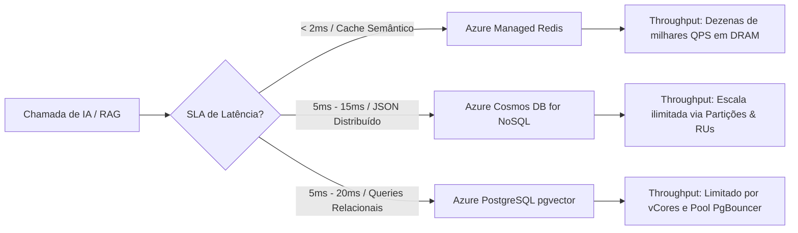
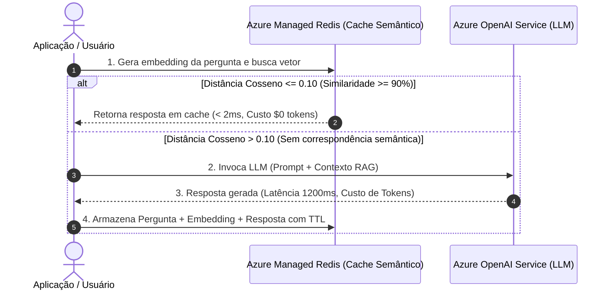

# Matriz Comparativa de Decisão: Bancos Vetoriais no Azure

No desenvolvimento de soluções de Inteligência Artificial Generativa e arquiteturas RAG (Retrieval-Augmented Generation) no Microsoft Azure, a escolha do mecanismo de armazenamento e busca vetorial impacta diretamente a **latência de inferência (P99)**, a **precisão semântica (Recall)**, o **custo operacional** e a **capacidade de escala horizontal**.

Para o exame **Microsoft Azure AI-200**, três serviços nativos de gerenciamento de dados constituem o núcleo das questões de arquitetura vetorial:
1. **Azure Cosmos DB for NoSQL**: Banco NoSQL multi-região orientado a documentos JSON com busca vetorial integrada (DiskANN, Flat, Quantized Flat).
2. **Azure Database for PostgreSQL Flexible Server com extensão `pgvector`**: Banco relacional transacional (ACID) que une dados relacionais, JSONB e vetores com índices HNSW e IVFFlat.
3. **Azure Managed Redis**: Armazenamento em memória (DRAM) de altíssimo desempenho com motor RediSearch, ideal para cache semântico e pipelines de baixa latência em sub-milissegundos.

---

## 1. Matriz Sintética de Decisão Rápida

A tabela abaixo sumariza as características críticas para seleção arquitetural no exame AI-200:

| Dimensão Técnica | Azure Cosmos DB for NoSQL | Azure PostgreSQL (`pgvector`) | Azure Managed Redis |
| :--- | :--- | :--- | :--- |
| **Paradigma Principal** | Distribuído NoSQL / JSON Document | Relacional ACID / Objeto-Relacional | In-Memory Key-Value / Multi-Modelo |
| **Algoritmos de Índice** | `diskann`, `quantizedFlat`, `flat` | `hnsw`, `ivfflat`, `flat` (sequencial) | `HNSW`, `FLAT` |
| **Métricas de Distância** | `cosine`, `dotproduct`, `euclidean` | Cosine (`<=>`), L2 (`<->`), Inner Product (`<#>`), L1 (`<+>`) | `COSINE`, `IP` (Inner Product), `L2` |
| **Tipos de Dados Vetoriais** | `float32`, `int8`, `uint8` | `vector(dim)` (float32), `halfvec(dim)` (float16) | `FLOAT32`, `FLOAT64` |
| **Dimensões Máximas** | Até 4.096 dimensões | Até 2.000 (HNSW) / 16.000 (sequencial) | Até 32.768 dimensões |
| **Latência Típica (P99)** | 5 ms – 15 ms (Single-partition) | 5 ms – 20 ms (Índice aquecido em RAM) | **< 1 ms – 2 ms (DRAM nativa)** |
| **Throughput / Escala** | Escala horizontal ilimitada via RUs | Escala vertical de vCores + Réplicas de leitura | Escala horizontal via Sharding de Cluster |
| **Filtragem de Metadados** | Nativa em JSON via índices invertidos | Poder relacional total (Joins, B-tree, GIN) | RediSearch (TAG, NUMERIC, TEXT) |
| **Busca Híbrida** | Vetor + Full-Text (RRF em preview) | Vetor (`<=>`) + FTS (`tsvector` / GIN) via SQL | Vetor + Full-Text Query RediSearch |
| **Modelo de Custo** | Provisionado/Autoscale RU/s + GB SSD | vCores computacionais + GB RAM + IOPS | Capacidade de DRAM provisionada por tier |
| **Caso de Uso Primário no Exame** | RAG global, alta ingestão, JSON semi-estruturado | RAG corporativo acoplado a dados relacionais | **Cache Semântico** e sessões de diálogo ultra-rápidas |

---

## 2. Análise Aprofundada por Dimensão Técnica

### 2.1 Algoritmos de Indexação e Métricas Matemáticas de Distância

A eficiência da busca vetorial depende do trade-off entre precisão matemática (recall), velocidade de consulta (QPS) e consumo de memória.

#### Azure Cosmos DB for NoSQL
- **`flat` (Força Bruta / kNN exato)**:
  - Realiza varredura linear $O(N)$ em todos os vetores da partição.
  - Oferece **100% de recall**, mas o consumo de Request Units (RUs) e a latência crescem proporcionalmente ao volume de itens.
  - Recomendado apenas para contêineres ou partições lógicas contendo menos de 1.000 documentos.
- **`quantizedFlat` (Flat Quantizado)**:
  - Aplica quantização escalar/vetorial antes do cálculo de distância, comprimindo vetores para caber no buffer de memória da partição física.
  - Reduz drasticamente a pegada de memória e acelera varreduras em coleções de tamanho moderado (até dezenas de milhares de vetores).
- **`diskann` (Disk-Accelerated Approximate Nearest Neighbor)**:
  - Baseado no algoritmo de grafo *Vamana* desenvolvido pela Microsoft Research.
  - O grafo e os vetores completos residem em discos SSD rápidos de baixo custo; apenas pontos de entrada e representações compactadas residem em memória RAM.
  - Permite indexar **bilhões de vetores** por partição física com recall > 95% e latência sub-10ms.
  - Suporta `cosine`, `dotproduct` e `euclidean`. A função SQL invocada é `VectorDistance(c.embedding, @queryVector)`.

#### Azure Database for PostgreSQL Flexible Server (`pgvector`)
- **`ivfflat` (Inverted File Flat)**:
  - Divide o espaço vetorial em partições Voronoi (`lists`). Na consulta, examina apenas os centroides mais próximos (`probes`).
  - **Construção rápida e baixa ocupação de memória**, mas sensível à distribuição inicial dos dados.
  - *Regra crítica*: Deve ser criado apenas após a tabela conter dados representativos (fórmula recomendada: `lists = sqrt(linhas)` para < 1M linhas ou `lists = linhas / 1000` para volumes maiores).
- **`hnsw` (Hierarchical Navigable Small World)**:
  - Constrói um grafo hierárquico multi-camada navegável.
  - **Não requer dados prévios** para criar o índice (suporta inserções contínuas com excelente estabilidade).
  - Oferece o maior recall (> 98%) e latência consistente sob alta concorrência.
  - Parâmetros de ajuste: `m` (número máximo de conexões por nó) e `ef_construction` (tamanho da fila dinâmica durante a criação). Em tempo de consulta, controla-se a precisão com `hnsw.ef_search`.
  - Ocupa significativamente mais memória RAM e exige alocação de `maintenance_work_mem` durante a indexação.
- **Tipo de dado `halfvec`**:
  - Armazena números em precisão reduzida (16 bits em vez de 32 bits IEEE 754), cortando pela metade o tamanho do índice HNSW em disco/RAM e dobrando o throughput com perda insignificante de recall.

#### Azure Managed Redis (RediSearch)
- **`HNSW`**:
  - Implementação nativa em memória C. Constrói grafo multi-camada onde toda a estrutura e vetores residem na DRAM.
  - Oferece latência P99 na ordem de **microssegundos** a sub-milissegundos.
  - Suporta inserções dinâmicas sem reconstrução ou perda de recall.
- **`FLAT`**:
  - Varredura em memória de alta performance. Útil quando o conjunto filtrado preliminarmente é reduzido ou quando o recall absoluto de 100% é mandatário.
- Métricas: `COSINE` (1 - similaridade cosseno), `IP` (Inner Product / Produto Escalar), `L2` (Distância Euclidiana ao quadrado).
- Sintaxe de criação via `FT.CREATE`:
  ```text
  FT.CREATE idx:documents ON HASH PREFIX 1 doc: SCHEMA
    content TEXT
    embedding VECTOR HNSW 6 TYPE FLOAT32 DIM 1536 DISTANCE_METRIC COSINE M 16 EF_CONSTRUCTION 200
  ```

---

### 2.2 Latência de Consulta vs Escalabilidade de Throughput



- **Azure Cosmos DB**:
  - A latência para consultas vetoriais com **partition key definida** é previsível e sub-10ms.
  - Em buscas globais sem chave de partição (*cross-partition vector search*), o gateway despacha consultas paralelas para todas as partições físicas e une os top-K no cliente. Isso multiplica a latência pelo nó mais lento e consome RUs de todas as partições físicas.
  - O throughput escala horizontalmente sem teto arquitetural bastando provisionar mais RUs ou adotar Autoscale.
- **Azure PostgreSQL (`pgvector`)**:
  - Latência excelente quando o índice HNSW cabe na memória (`shared_buffers` e cache de SO). Se o índice vazar para armazenamento gerenciado (IOPS de disco), a latência se degrada de 10ms para mais de 100ms.
  - O throughput em cargas de IA com alta concorrência sofre com a sobrecarga de conexão do PostgreSQL (processo por conexão). **O uso de PgBouncer integrado é obrigatório** para evitar saturação de processos e esgotamento de conexões.
- **Azure Managed Redis**:
  - O campeão absoluto em latência: 0.5 ms a 2 ms.
  - Throughput sustentado em mais de 100.000 QPS por nó primário em operações em memória.
  - A escalabilidade se dá por sharding de cluster Redis Enterprise ou réplicas de leitura para distribuição de consultas de similaridade.

---

### 2.3 Filtragem de Metadados e Busca Híbrida

Em arquiteturas RAG reais, a busca vetorial nunca ocorre isolada; quase sempre é combinada com restrições de permissão de usuário (`tenant_id`, `department`), intervalos de data ou termos de pesquisa léxica (palavras-chave).

#### Filtragem de Metadados
- **Cosmos DB**:
  - A consulta SQL permite combinar predicados escalares e vetor no mesmo comando:
    ```sql
    SELECT TOP 5 c.id, c.text, VectorDistance(c.embedding, @queryVector) AS SimilarityScore
    FROM c
    WHERE c.tenantId = @tenantId AND c.status = 'published' AND c.year >= 2025
    ORDER BY VectorDistance(c.embedding, @queryVector)
    ```
  - Os índices invertidos padrão do Cosmos DB avaliam os filtros antes ou durante a varredura DiskANN, otimizando o número de nós de grafo examinados.
- **PostgreSQL (`pgvector`)**:
  - Suporte sem paralelos para filtros complexos: joins com tabelas de controle de acesso (RBAC), operadores JSONB (`@>`, `?`), expressões B-tree e restrições geográficas (PostGIS).
  - Nas versões modernas do `pgvector`, o *iterative index scan* permite empurrar o predicado `WHERE` para dentro do grafo HNSW, evitando o problema de retorno vazio quando o filtro prévio elimina a maioria dos nós mais próximos.
- **Azure Managed Redis**:
  - O RediSearch suporta pré-filtragem estrita através de tags (`@tenant:{tenantA}`), campos numéricos (`@timestamp:[1700000000 +inf]`) e texto:
    ```text
    FT.SEARCH idx:documents "(@tenant:{finance})=>[KNN 5 @embedding $query_vec AS score]" PARAMS 2 query_vec "..." SORTBY score DIALECT 2
    ```

#### Busca Híbrida (Lexical + Vector)
- **PostgreSQL**: Realizada combinando `tsvector` com `to_tsquery` (PostgreSQL Full-Text Search com índices GIN) e distância vetorial `<=>`. As pontuações podem ser combinadas via fórmula ponderada ou Reciprocal Rank Fusion (RRF) em SQL puro.
- **Azure Managed Redis**: O RediSearch combina nativamente consultas booleanas de texto completo com KNN vetorial.
- **Cosmos DB**: Suporta busca híbrida combinando funções de texto e `VectorDistance` utilizando classificação RRF gerenciada.

---

### 2.4 Modelos de Preço, Drivers de Custo e Isolamento Multi-Tenancy

| Fator de Custo / Operação | Azure Cosmos DB for NoSQL | Azure PostgreSQL (`pgvector`) | Azure Managed Redis |
| :--- | :--- | :--- | :--- |
| **Unidade Básica de Cobrança** | Request Units por segundo (RU/s) + GB Armazenamento | vCore / Hora + RAM + GB SSD + IOPS provisionadas | Nível de Instância (Capacidade de DRAM em GB / Mês) |
| **Impacto de Volume Vetorial no Custo** | Baixo a moderado: dados residem em SSD de baixo custo | Moderado: requer RAM suficiente para cache do índice | **Alto**: 100% dos vetores e grafos residem em DRAM |
| **Custo de Consultas Ociosas** | Zero em modo Serverless; fixo mínimo em Autoscale | Fixo contínuo por instância (vCore ativo 24/7) | Fixo contínuo por instância de memória alocada |
| **Estratégia Multi-Tenancy** | Partição Lógica (`/tenantId`) com isolamento por chave | Row-Level Security (RLS) no PostgreSQL ou Esquemas | Prefixos de chave (`tenant:A:*`) com ACLs ou Instâncias |

#### Comparativo de Custo por Milhão de Vetores
- Um milhão de embeddings gerados pelo modelo `text-embedding-3-small` (1.536 dimensões em `float32`) ocupa:
  $$1.536 \times 4 \text{ bytes} \approx 6.144 \text{ bytes (apenas vetor cru)}$$
- No **Azure Managed Redis**, somando os ponteiros e o grafo HNSW (adicional de ~40% a 70%), 1 milhão de vetores requer cerca de **9 a 10 GB de DRAM**, o que exige tiers equilibrados ou de memória dedicada com custo proporcionalmente elevado.
- No **Cosmos DB com DiskANN**, os 6 GB de vetores e o grafo Vamana ficam em disco SSD (~US$ 0,25/GB/mês). Paga-se apenas pelo throughput de leitura (RUs) consumido nas consultas.
- No **PostgreSQL com HNSW**, os dados ficam no SSD, mas para manter a latência de 10ms, a instância de servidor flexível deve possuir tamanho de memória (`RAM`) que acolha o índice HNSW (~8-10 GB) mais os dados relacionais, apontando para o tier *Memory Optimized* (8 GB por vCore).

---

### 2.5 Sobrecarga Operacional e Integração com o Ecossistema de IA

#### Orquestração com LangChain e Semantic Kernel
- **Azure Cosmos DB**:
  - LangChain: `AzureCosmosDBNoSqlVectorSearch`
  - Semantic Kernel: `CosmosDbNoSqlMemoryStore`
  - Abstração completa de infraestrutura: atualizações de esquema, particionamento e réplicas gerenciadas pela Microsoft sem janelas de manutenção.
- **Azure PostgreSQL**:
  - LangChain: `PGVector`
  - Semantic Kernel: `PostgreSqlMemoryStore`
  - Requer governança de banco de dados: execução de `VACUUM ANALYZE`, configuração de `maintenance_work_mem` para indexação em lote e monitoramento de buffers.
- **Azure Managed Redis**:
  - LangChain: `Redis`
  - Semantic Kernel: `RedisMemoryStore`
  - Requer governança de ciclo de vida de dados: definição de TTL para descarte de sessões expiradas, política de eviction (`volatile-lru` ou `noeviction`) e dimensionamento de memória para prevenir quedas por Out-Of-Memory (OOM).

#### Padrão de Arquitetura: Cache Semântico com Azure Managed Redis
O uso de vetores no Redis brilha especialmente no padrão de **Cache Semântico** acoplado ao Azure OpenAI Service:



---

## 3. Árvore de Decisão Rápida para o Exame AI-200

Nas questões de cenário do exame AI-200, identifique as palavras-chave determinantes:

1. **Escolha Azure Cosmos DB for NoSQL se**:
   - O enunciado exigir distribuição geográfica multi-região nativa com replicação multi-mestre e SLAs de 99.999%.
   - A carga de trabalho envolver documentos JSON semi-estruturados com alta taxa de ingestão e necessidade de busca vetorial integrada sem manter dois sistemas separados.
   - O volume de vetores for de centenas de milhões a bilhões e o custo de DRAM dedicada for proibitivo (vantagem do DiskANN sobre SSD).
   - O isolamento de clientes for modelado com alta granularidade via **Partition Key**.

2. **Escolha Azure Database for PostgreSQL Flexible Server (`pgvector`) se**:
   - A solução de IA necessitar de transações ACID completas e relações complexas (joins com tabelas ERP, CRM, dados financeiros).
   - A equipe de engenharia possuir expertise em PostgreSQL e quiser evitar a proliferação de novos bancos de dados na arquitetura.
   - For exigido isolamento estrito via Row-Level Security (RLS) no mesmo banco de dados relacional.
   - A busca híbrida depender fortemente de consultas léxicas avançadas via PostgreSQL Full-Text Search.

3. **Escolha Azure Managed Redis se**:
   - O requisito de latência for estrito em **sub-milissegundos** ou tempo real crítico (gaming, cotações financeiras, agentes interativos de voz).
   - O objetivo for implementar **Cache Semântico** para respostas de LLM (evitando chamadas repetidas ao Azure OpenAI e reduzindo custos de tokens).
   - O caso de uso for armazenamento de memória de curto prazo de agentes de IA, histórico de conversação de sessão com expiração automática (TTL).

---

## Pegadinhas de Prova

- **Pegadinha 1 (Imutabilidade da Política Vetorial no Cosmos DB)**:
  A política de embedding vetorial (`vectorEmbeddingPolicy`) do Azure Cosmos DB for NoSQL é **imutável**. Ela deve ser definida obrigatoriamente no momento da **criação do contêiner**. Se um contêiner for criado sem a política vetorial, não é possível habilitar a indexação vetorial nele posteriormente; é necessário criar um novo contêiner e migrar os dados.
- **Pegadinha 2 (Custo RU de Busca Vetorial Cross-Partition no Cosmos DB)**:
  Executar uma consulta com `VectorDistance` sem especificar o predicado da chave de partição no `WHERE` provoca uma varredura em **todas as partições físicas** do contêiner. Em bases com dezenas de partições físicas, o consumo de RUs explode exponencialmente, resultando em throttling (HTTP 429 - *Too Many Requests*). Para isolamento multi-tenant, sempre inclua a chave de partição na cláusula `WHERE`.
- **Pegadinha 3 (Ativação em Duas Etapas do pgvector no PostgreSQL)**:
  Para utilizar o `pgvector` no Azure Database for PostgreSQL Flexible Server, não basta executar `CREATE EXTENSION vector;`. Antes disso, é obrigatório adicionar `vector` ao parâmetro de servidor `azure.extensions` através do Azure Portal, Azure CLI ou ARM/Bicep template. Se o parâmetro não for configurado no nível do servidor, o comando SQL falhará informando que a extensão não está na lista de permissões.
- **Pegadinha 4 (IVFFlat em Tabelas Vazias no PostgreSQL)**:
  Criar um índice `ivfflat` em uma tabela sem dados (ou com pouquíssimas linhas) gera centroides aleatórios ou vazios. Conforme a tabela cresce com novos embeddings, as buscas terão **recall péssimo**, não encontrando os vizinhos mais próximos. Se os dados ainda não foram carregados, o índice correto a ser criado é o **HNSW** (que suporta construções incrementais), ou deve-se aguardar a carga inicial completa antes de criar o `ivfflat`.
- **Pegadinha 5 (Sobrecarga de Memória e OOM no Azure Managed Redis)**:
  O Azure Managed Redis armazena os índices vetoriais inteiramente em memória RAM. Vetores de alta dimensionalidade (ex.: 1.536 dimensões em `FLOAT32`) consomem cerca de 6 KB por vetor apenas em dados brutos, mais o grafo HNSW. Se a memória máxima (`maxmemory`) for atingida e a política de eviction for `noeviction`, o Redis rejeitará operações de escrita com erro OOM (*Out Of Memory*). Sempre dimensione a memória considerando o overhead do grafo e utilize políticas de expiração (TTL) quando aplicável.
- **Pegadinha 6 (PgBouncer e Esgotamento de Conexões no PostgreSQL)**:
  Aplicações de IA baseadas em microserviços assíncronos (como Azure Functions ou Container Apps) geram centenas de conexões simultâneas ao banco de dados. Como cada conexão nativa do PostgreSQL aloca um processo do sistema operacional e memória de trabalho (`work_mem`), a ausência do pool de conexões **PgBouncer** (recurso integrado nativamente no Flexible Server) leva ao esgotamento de conexões (*Too many connections*) e saturação de CPU da instância.
