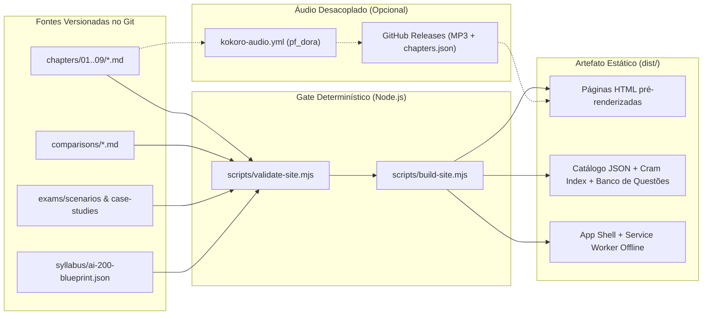

# Plano de Arquitetura e Implementação — Azure AI-200 Study Hub

Plataforma estática de estudo ativo, revisão e simulados para a certificação **Microsoft Certified: Azure AI Cloud Developer Associate (Exame AI-200 / Curso AI-200T00)**, publicada via GitHub Pages seguindo a engenharia de build e validação do `joaovpimenta/tech-topics`.

---

## 1. Síntese das Decisões Alinhadas

| Dimensão | Decisão Definida |
| :--- | :--- |
| **Mecânicas de Retenção** | Active Recall na leitura (`==cloze==` e blocos `<details>`), Simulados estilo Microsoft, Modo Cram Sheet + Matrizes de Decisão, Mapa de Cobertura e Confiança, e Revisão em Áudio (PWA/Mobile). |
| **Estrutura de Capítulos** | **9 diretórios** mapeados para as Trilhas de Aprendizagem do curso `AI-200T00` + campo `exam_domain` no frontmatter cruzando com os **4 domínios e pesos oficiais** da prova. |
| **Organização dos Dados** | **Híbrida**: cada `<conceito>.md` reúne resumo, active recall, pegadinhas e questões rápidas do conceito; diretórios transversais guardam Matrizes de Decisão (`comparisons/`) e Case Studies / cenários multi-serviço (`exams/`). |
| **Herança do `tech-topics`** | Compilador Node (`build-site.mjs` -> `dist/`), gate único (`validate-site.mjs`), workflows de PR e Pages, busca client-side, Mermaid e PWA offline — **sem** exigir capa em aquarela ou abertura em diálogo-metáfora por conceito. |
| **Revisão em Áudio** | **Híbrida desacoplada**: Web Speech API imediata no navegador + workflow opcional/assíncrono Kokoro (`pf_dora`) gerando MP3 em GitHub Releases (com Media Session API e playlist por capítulo para ouvir com tela bloqueada no celular, sem bloquear deploys rápidos). |
| **Motor de Simulados** | Suporte a **5 formatos/modos**: Múltipla escolha (1 ou N corretas com justificativa por opção e link MS Learn), Completar código/CLI/YAML/KQL, Ordenação de etapas, Case Studies com abas de cenário e **Caderno de Erros / Marcadas**. |
| **Contrato do `.md`** | **Semi-estruturado**: frontmatter obrigatório (`title`, `slug`, `chapter`, `exam_domain`, `tags`, `related_links`, `tldr`), seções técnicas livres, seção obrigatória `## Pegadinhas de Prova` e marcações de Active Recall legíveis no GitHub puro. |
| **Trilha de Linguagem SDK** | **Python e C#** simultaneamente (abas sincronizadas nos exemplos de SDK + seletor de linguagem da prova nos simulados de código), além de Azure CLI, YAML e KQL. |
| **Progresso e Sync** | **Offline-first** em `localStorage` + Exportar/Importar JSON + **Sync opcional via GitHub Gist privado** (token local com escopo `gist`) entre PC e PWA mobile. |
| **Escopo Inicial** | Plataforma completa + ementa 100% mapeada das 9 trilhas no `ai-200-blueprint.json` + **1 capítulo piloto completo** + sistema de templates/briefs (`generation/`) para expandir capítulo a capítulo. |

---

## 2. Arquitetura do Repositório e Fluxo de Build



### Estrutura de Pastas Proposta

```text
azure-ai-200/
├── .github/workflows/
│   ├── validate.yml                  # Gate em PRs e pushes (node scripts/validate-site.mjs)
│   ├── pages.yml                     # Valida, gera dist/ e publica no GitHub Pages
│   └── kokoro-audio.yml              # Gera MP3 (pf_dora) em Releases via workflow_dispatch ou pós-deploy sem travar Pages
├── syllabus/
│   └── ai-200-blueprint.json         # 4 domínios oficiais (com pesos %) + 9 trilhas + todos os conceitos planejados da ementa
├── chapters/
│   ├── 01-container-hosting/         # Trilha 1: ACR, ACR Tasks, App Service Containers
│   ├── 02-container-apps/            # Trilha 2: ACA, Revisions, KEDA, Dynamic Sessions
│   ├── 03-aks/                       # Trilha 3: AKS Deployments, Networking, Ingress, Logs
│   ├── 04-cosmos-db-nosql/           # Trilha 4 (PILOTO): SDK Python/C#, RU/Indexing, Vector Search, Change Feed
│   ├── 05-postgresql-pgvector/       # Trilha 5: Azure PostgreSQL, pgvector, HNSW/IVFFlat, RAG
│   ├── 06-managed-redis/             # Trilha 6: Caching, Streaming, Redis Vector Search
│   ├── 07-backend-integration/       # Trilha 7: Azure Functions, Service Bus, Event Grid, Resiliência SDK
│   ├── 08-secrets-and-config/        # Trilha 8: Key Vault, App Configuration, Entra ID, Managed Identity
│   └── 09-observe-and-troubleshoot/  # Trilha 9: Azure Monitor, Application Insights, OpenTelemetry, KQL
├── comparisons/
│   └── vector-stores-azure.md        # Matriz piloto: Cosmos DB NoSQL vs PostgreSQL pgvector vs Managed Redis
├── exams/
│   ├── scenarios/                    # Questões transversais multi-serviço (JSON/YAML estruturado)
│   └── case-studies/                 # Estudos de caso com abas de contexto + bateria de questões
├── generation/
│   ├── taxonomy/tags.json            # Tags canônicas validadas no build
│   ├── templates/                    # Templates para conceito, matriz comparativa e estudo de caso
│   └── AUTHORING.md                  # Guia de autoria enxuto focado em retenção para prova
├── scripts/
│   ├── doctor.mjs                    # Diagnóstico rápido do ambiente local
│   ├── validate-site.mjs             # Comando único de validação (local + CI)
│   ├── build-site.mjs                # Compilador estático gerando dist/
│   ├── compose-study-brief.mjs       # Gerador de brief por conceito/trilha para criação sob demanda
│   └── lib/                          # Parser frontmatter/GFM, transformador cloze/tabs Python-C#, validador de esquemas
├── tools/tts/                        # Adaptação enxuta do segmentador/síntese Kokoro (pf_dora) para resumos técnicos
├── web/                              # Shell estático da aplicação (HTML, CSS, JS modular, Mermaid theme, PWA SW)
│   ├── index.html
│   ├── styles.css
│   ├── app.js                        # Roteamento SPA/MPA híbrido, busca, filtros e atalhos de teclado
│   ├── reader.js                     # Active recall (==cloze==, <details>), abas Python/C# e status de domínio
│   ├── cram.js                       # Visão Cram Sheet (TL;DR + Pegadinhas agregadas + Matrizes de Decisão)
│   ├── simulator.js                  # Motor de simulados (5 formatos, timer, filtro Python/C#, Caderno de Erros)
│   ├── mastery.js                    # Mapa de Cobertura ponderado pelos domínios + Sync localStorage / JSON / Gist
│   ├── audio-player.js               # Player unificado (MP3 Release + Media Session API + fallback Web Speech + Playlist)
│   ├── mermaid-theme.js
│   ├── manifest.webmanifest
│   └── sw.js
└── docs/
    └── PLAN.md
```

> [!TIP]
> **Escolha do Capítulo Piloto (`04-cosmos-db-nosql`)**: Ele representa o domínio de **maior peso individual na prova AI-200 (25–30%)**, exercita intensamente código **Python (`azure-cosmos`) e C# (`Microsoft.Azure.Cosmos`)**, políticas JSON de indexação vetorial, Change Feed, cálculo/otimização de RUs e conecta-se diretamente à matriz comparativa de bancos vetoriais (*Cosmos DB vs PostgreSQL `pgvector` vs Managed Redis*). Caso prefira iniciar pela Trilha `01-container-hosting`, podemos trocar antes da execução sem impacto arquitetural.

---

## 3. Contratos de Conteúdo e Formatos Interativos

### 3.1. Contrato do Arquivo `<conceito>.md`

1. **Frontmatter YAML obrigatório**:
   ```yaml
   ---
   title: "Busca Vetorial e Políticas de Indexação no Cosmos DB for NoSQL"
   slug: "cosmos-db-vector-search-indexing"
   chapter: "04-cosmos-db-nosql"
   exam_domain: "data-management" # containerized-solutions | data-management | connect-and-consume | secure-monitor-troubleshoot
   tags: ["cosmos-db", "vector-search", "rag", "indexing", "nosql"]
   difficulty: "intermediate"
   tldr: "Exige vectorEmbeddingPolicy no contêiner (imutável após criação nos parâmetros base) + índice vetorial (flat, quantizedFlat ou diskANN) e consulta via função de sistema VectorDistance()."
   related_links:
     - label: "MS Learn — Vector Search in Azure Cosmos DB for NoSQL"
       url: "https://learn.microsoft.com/pt-br/azure/cosmos-db/nosql/vector-search"
       type: "mslearn"
     - label: "Conceito relacionado — Consistência e Request Units (RUs)"
       url: "/chapters/04-cosmos-db-nosql/cosmos-db-consistency-and-rus/"
       type: "internal"
   ---
   ```
2. **Active Recall legível no GitHub puro**:
   - **Cloze inline (`==...==`)**: Exemplo: `A função SQL usada para calcular similaridade no Cosmos DB NoSQL é ==VectorDistance==, e o tipo de índice recomendado para alta escala com baixa latência é ==diskANN==.`
     - No GitHub: renderiza texto legível destacado.
     - Na GitHub Page: com o **Modo Active Recall** ativo, vira uma lacuna oculta interativa (clicável/navegável por `Tab`/`Espaço`), com contador de acertos na leitura.
   - **Perguntas de checagem rápida (`<details>`)**: Blocos nativos HTML5 `<details>` estilizados como cartões "Tente responder antes de abrir".
3. **Abas de Linguagem (`Python` | `C#`)**:
   - Dois blocos fenced consecutivos (` ```python ` seguido de ` ```csharp `) são agrupados automaticamente pelo compilador em um componente de **Abas Sincronizadas** no site, mantendo leitura linear limpa no GitHub puro.
4. **Seção obrigatória `## Pegadinhas de Prova`**:
   - Validada por `validate-site.mjs`; extraída durante o build para compor automaticamente a visão consolidada do **Modo Cram Sheet**.

### 3.2. Esquema dos 5 Formatos de Questão de Simulado

Validado por `validate-site.mjs` (tanto em `questions` locais de conceitos quanto em `exams/scenarios/*.json` e `exams/case-studies/*.json`):
- `single-choice` e `multiple-choice`: enunciado contextualizado, indicação explícita de quantas opções marcar, `rationale` individual explicando por que **cada** opção está certa ou errada, `mslearn_url` de referência, `exam_domain`, `chapter` e `language` (`agnostic` | `python` | `csharp`).
- `code-completion`: template de código (`python`, `csharp`, `azurecli`, `yaml` ou `kql`) com placeholders `{{slot_1}}`, `{{slot_2}}` e opções específicas para cada lacuna + explicação técnica.
- `ordering`: lista de etapas embaralhadas no cliente e gabarito ordenado com explicação da dependência entre os passos.
- `case-study`: objeto pai com abas estruturadas (`Visão Geral`, `Arquitetura Atual`, `Requisitos Técnicos`, `Requisitos de Segurança`) + array de questões filhas de qualquer um dos formatos acima.

---

## 4. Funcionalidades de Estudo, Progresso e Mobile/PWA

1. **Mapa de Cobertura e Confiança (`mastery.js`)**:
   - Lê `syllabus/ai-200-blueprint.json` contendo os **4 Domínios Oficiais** (20–25%, 25–30%, 20–25%, 20–25%) e todos os tópicos previstos nas **9 Trilhas**.
   - Exibe duas métricas claras por domínio e trilha:
     - **Cobertura Editorial**: `%` de conceitos da ementa já resumidos no repositório.
     - **Prontidão Pessoal (Score Ponderado)**: calculado a partir do status marcado pelo usuário (`Não visto`, `Estudando`, `Revisar`, `Dominado`) + taxa de acerto nos simulados daquele domínio.
2. **Caderno de Erros & Sync GitHub Gist**:
   - Toda questão errada ou marcada com bandeira ("Revisar") entra automaticamente no **Caderno de Erros**, com botão **"Treinar apenas minhas falhas"**.
   - Camada de armazenamento em `localStorage` com `schemaVersion`, botão de **Exportar / Importar `.json`**, e modal leve de **Sincronização GitHub Gist** (salva/atualiza um arquivo `azure-ai-200-progress.json` em um Gist secreto usando `fetch` direto para `api.github.com/gists` com merge por timestamp).
3. **Revisão em Áudio Desacoplada (`audio-player.js` + `kokoro-audio.yml`)**:
   - Extrai um roteiro limpo de fala para cada conceito (`narrationText`: título, `tldr`, prosa das seções e `Pegadinhas de Prova`, convertendo código extenso em descrições curtas ou pulando blocos brutos).
   - Se existir release `tts-<slug>` com MP3 (`pf_dora`), usa `<audio>` nativo + **Media Session API** (funciona com tela bloqueada no iOS/Android e controles no fone Bluetooth) + destaque de frases; caso contrário, usa **Web Speech API** imediatamente sem quebrar a experiência.
   - Inclui modo **"Ouvir Trilha em Sequência"** (playlist contínua dos conceitos do capítulo).

---

## 5. Etapas de Execução (Fases de Implementação)

### Fase 1 — Fundação, Ementa Completa e Toolchain de Build/Validação
- Configurar `package.json`, `.node-version`, `.python-version`, `.gitignore`, `.nojekyll` e `scripts/doctor.mjs`.
- Criar `syllabus/ai-200-blueprint.json` mapeando fielmente os 4 domínios oficiais da prova AI-200 e todos os módulos/conceitos das 9 trilhas do curso `AI-200T00`.
- Implementar `scripts/lib/` e `scripts/build-site.mjs` (parser de frontmatter YAML, compilador Markdown seguro, transformador de `==cloze==`, `<details>`, abas `Python | C#`, Mermaid figure com fallback, extrator de Cram Sheet, agregador de simulados e gerador de `dist/`).
- Implementar `scripts/validate-site.mjs` (validação estrita de frontmatter, taxonomia de tags, links internos, presença de `## Pegadinhas de Prova`, integridade dos 5 tipos de questão, paridade de abas de código e segurança HTML sem scripts inline).

### Fase 2 — Frontend Estático de Estudo, Retenção, Simulados e PWA
- Construir o design system responsivo (modo claro/escuro confortável para leitura longa, sem scroll horizontal na página, tipografia editorial limpa + componentes técnicos de alta densidade).
- Implementar as 4 visões principais:
  1. **Trilhas & Leitor de Conceito** (navegação por trilha/domínio, busca instantânea, Modo Active Recall, seletor global `Python | C# | Ambos`, Mermaid client-side e player de áudio com playlist).
  2. **Cram Sheet & Matrizes Comparativas** (visão rápida de véspera filtrável por domínio + tabelas comparativas de decisão).
  3. **Simulador AI-200 & Caderno de Erros** (Modo Estudo vs Modo Exame Cronometrado, filtro `Python | C#`, renderizadores dos 5 formatos de questão e revisão pós-prova por domínio).
  4. **Mapa de Cobertura & Sincronização** (dashboard ponderado pelos pesos da prova + Export/Import JSON + Sync via GitHub Gist privado).
- Configurar PWA instalável (`manifest.webmanifest` + `sw.js` com cache versionado offline para estudar resumos e simulados sem internet).

### Fase 3 — Capítulo Piloto Completo & Sistema de Geração Sob Demanda
- Escrever o capítulo piloto **`04-cosmos-db-nosql`** completo (conceitos `.md` cobrindo SDK Python/C#, consistência/RUs, políticas de indexação, Vector Search `DiskANN` e Change Feed para pipelines de IA).
- Criar a matriz comparativa piloto em `comparisons/vector-stores-azure.md` (*Cosmos DB for NoSQL vs Azure Database for PostgreSQL `pgvector` vs Azure Managed Redis*).
- Criar um pacote piloto completo em `exams/` contendo questões nos **5 formatos** (incluindo `code-completion` para Python e C#, `ordering` e 1 `case-study` multi-aba realista).
- Criar `generation/` + `scripts/compose-study-brief.mjs` para facilitar a geração padronizada dos próximos capítulos conforme o avanço nos estudos.

### Fase 4 — CI/CD GitHub Actions, Pipeline Kokoro Desacoplado e Testes Automatizados
- Configurar `.github/workflows/validate.yml` (gate em Pull Requests) e `.github/workflows/pages.yml` (deploy automático de `dist/` para GitHub Pages em pushes na `main`).
- Configurar `tools/tts/` e `.github/workflows/kokoro-audio.yml` (geração opcional/assíncrona de MP3 com `pf_dora` em Releases sem bloquear deploys de texto).
- Adicionar suíte automatizada de testes (`npm test` / `node scripts/validate-site.mjs`) cobrindo compilador Markdown, transformações de Active Recall, motor de pontuação dos 5 tipos de questão e integridade do artefato `dist/`.
