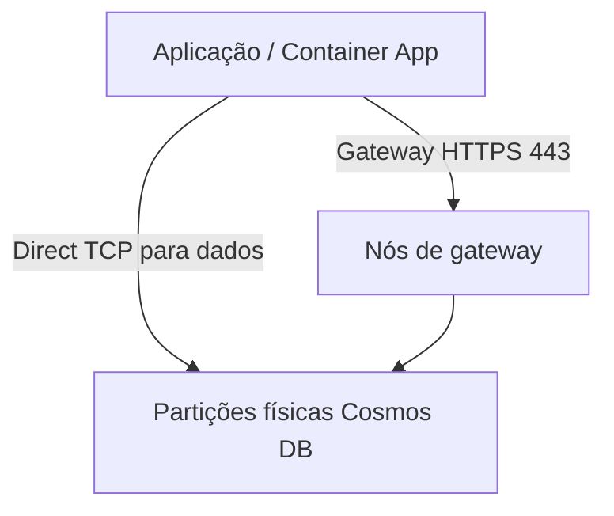

# Título Oficial do Conceito

Comece com uma decisão de aplicação. O assistente precisa reabrir um trecho de um cliente e já conhece o ID do item e a chave de partição. Qual operação você usaria para encontrá-lo?

## Fundamentos e Arquitetura

Explicação técnica profunda dos mecanismos fundamentais. Integre as marcações de **Active Recall** para fixação de termos críticos:

O Azure Cosmos DB utiliza o particionamento horizontal para distribuir dados e throughput através de ==partições físicas== gerenciadas automaticamente, enquanto as aplicações particionam seus documentos logicamente por meio da ==partition key==.

<details>
<summary>Checagem rápida · O que acontece se a aplicação só conhece o ID do trecho?</summary>

Ela precisa obter a chave completa ou consultar por outros critérios. Uma leitura pontual exige o ID e a chave de partição.

</details>

### Detalhes Técnicos e Comportamento Operacional

Aprofundamento sobre configurações operacionais, comportamento sob carga, métricas de desempenho e melhores práticas recomendadas pela Microsoft.

## Implementação Prática Dual SDK

Defina `COSMOS_ENDPOINT`. No contêiner `KnowledgeDb/DocumentEmbeddings`, com chave `/tenantId`, prepare um item `doc-1` com `tenantId` igual a `tenant-a`. Autorize a identidade com `Cosmos DB Built-in Data Reader`. Instale `azure-cosmos` e `azure-identity` em Python ou `Microsoft.Azure.Cosmos` e `Azure.Identity` em .NET.

```python
import os
from azure.cosmos import CosmosClient
from azure.identity import DefaultAzureCredential

with DefaultAzureCredential() as credential:
    with CosmosClient(os.environ["COSMOS_ENDPOINT"], credential) as client:
        container = client.get_database_client("KnowledgeDb").get_container_client("DocumentEmbeddings")
        print(container.read_item(item="doc-1", partition_key="tenant-a")["id"])
```

```csharp
using System;
using Microsoft.Azure.Cosmos;
using Azure.Identity;

using var client = new CosmosClient(
    Environment.GetEnvironmentVariable("COSMOS_ENDPOINT")!, new DefaultAzureCredential(),
    new CosmosClientOptions { ConnectionMode = ConnectionMode.Gateway });
var container = client.GetContainer("KnowledgeDb", "DocumentEmbeddings");
var item = await container.ReadItemAsync<dynamic>("doc-1", new PartitionKey("tenant-a"));
Console.WriteLine(item.Resource.id);
```

Os dois exemplos devem imprimir `doc-1`. Se mudar apenas a chave para `tenant-b` e esse par não existir, a leitura deve indicar item não encontrado.

## Diagrama Arquitetural

Utilize diagramas Mermaid compatíveis com renderização estática limpa:



## Pegadinhas de Prova

- **Pegadinha 1: Imutabilidade da Partition Key**: A chave de partição (`partitionKey`) de um container **NÃO** pode ser alterada após a criação. Para alterar a estratégia de particionamento, é mandatório criar um novo container e migrar os dados via Azure Data Factory, Spark ou Change Feed.
- **Portas do Direct Mode.** O .NET pode usar TCP `10000–20000` com endpoints públicos ou de serviço; private endpoints podem usar outra faixa. Se a rede só permite `443`, Gateway usa HTTPS para NoSQL.
- **Leitura pontual e consulta.** Uma consulta sem a chave pode se espalhar por várias partições, dependendo dos filtros. Compare RUs por operação para medir o efeito no seu caso.
