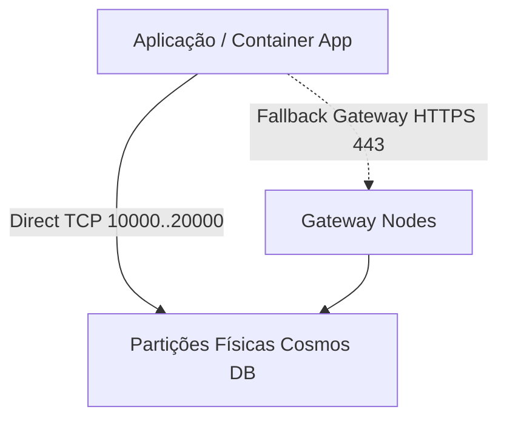

# Título Oficial do Conceito

Contextualização inicial do conceito dentro do escopo do exame **Azure AI-200 (Developing AI Cloud Solutions on Azure)**, destacando sua relevância arquitetural e impacto no design de sistemas inteligentes.

## Fundamentos e Arquitetura

Explicação técnica profunda dos mecanismos fundamentais. Integre as marcações de **Active Recall** para fixação de termos críticos:

O Azure Cosmos DB utiliza o particionamento horizontal para distribuir dados e throughput através de ==partições físicas== gerenciadas automaticamente, enquanto as aplicações particionam seus documentos logicamente por meio da ==partition key==.

<details>
<summary>Checagem Rápida: Qual o limite máximo de armazenamento de uma única partição lógica no Cosmos DB?</summary>

Cada partição lógica possui o limite estrito de **20 GB** de dados. Quando uma partição lógica atinge esse volume sem particionamento adequado, o Cosmos DB rejeita novas gravações gerando erros de cota de armazenamento.
</details>

### Detalhes Técnicos e Comportamento Operacional

Aprofundamento sobre configurações operacionais, comportamento sob carga, métricas de desempenho e melhores práticas recomendadas pela Microsoft.

## Implementação Prática Dual SDK

Apresente sempre os blocos consecutivos em Python e C#. O compilador agrupa automaticamente blocos adjacentes em abas sincronizadas interativas:

```python
from azure.cosmos import CosmosClient, PartitionKey
from azure.identity import DefaultAzureCredential

endpoint = "https://ai200-cosmos.documents.azure.com:443/"
credential = DefaultAzureCredential()

client = CosmosClient(url=endpoint, credential=credential, connection_mode="direct")
database = client.create_database_if_not_exists(id="KnowledgeDb")
container = database.create_container_if_not_exists(
    id="DocumentEmbeddings",
    partition_key=PartitionKey(path="/documentCategory")
)
```

```csharp
using System;
using Microsoft.Azure.Cosmos;
using Azure.Identity;

string endpoint = "https://ai200-cosmos.documents.azure.com:443/";
CosmosClient client = new CosmosClient(
    accountEndpoint: endpoint,
    tokenCredential: new DefaultAzureCredential(),
    clientOptions: new CosmosClientOptions { ConnectionMode = ConnectionMode.Direct }
);

Database database = await client.CreateDatabaseIfNotExistsAsync("KnowledgeDb");
Container container = await database.CreateContainerIfNotExistsAsync(
    id: "DocumentEmbeddings",
    partitionKeyPath: "/documentCategory"
);
```

## Diagrama Arquitetural

Utilize diagramas Mermaid compatíveis com renderização estática limpa:



## Pegadinhas de Prova

- **Pegadinha 1: Imutabilidade da Partition Key**: A chave de partição (`partitionKey`) de um container **NÃO** pode ser alterada após a criação. Para alterar a estratégia de particionamento, é mandatório criar um novo container e migrar os dados via Azure Data Factory, Spark ou Change Feed.
- **Pegadinha 2: Portas do Direct Mode**: O Direct Mode conecta-se diretamente às réplicas backend através de portas TCP dinâmicas no intervalo de `10000 a 20000`. Se o tráfego de saída da VNet/firewall corporativo permitir apenas a porta `443`, a aplicação falhará com timeouts a menos que seja configurada explicitamente com `ConnectionMode.Gateway`.
- **Pegadinha 3: Consultas Cross-Partition**: Consultas sem a especificação da chave de partição no filtro `WHERE` ou nas opções de requisição forçam uma varredura em leque (fan-out) por todas as partições físicas, consumindo ordens de grandeza a mais em Request Units (RU/s).
